import { Image } from 'astro:assets';
import Background from '../../../../assets/sprints/sprint1/background_title.png';

  <Image src={Background} alt="Banner Motiva" format="png" style="position: absolute; inset: 0; width: 100%; height: 100%; object-fit: cover; z-index: 0;"/>
  <h2 style="position: relative; z-index: 1; color: white; margin: 0;">1. O que é Arquitetura UML</h2>

**UML (Unified Modeling Language)** é uma estrutura usada para representar visualmente a arquitetura, o comportamento e as interações de um sistema de software, independente da linguagem de implementação. Seu papel é comunicar decisões de design de forma clara entre as pessoas envolvidas no projeto, antes ou durante a construção do sistema.

Os diagramas UML se dividem em duas famílias. Os **estruturais** mostram a "anatomia" do sistema, ou seja, o que existe e como se relaciona: Classes, Objetos, Componentes, Implantação, Pacotes e Estrutura Composta. Já os **comportamentais** mostram o "funcionamento" do sistema ao longo do tempo: Casos de Uso, Atividades, Sequência, Máquina de Estados, Comunicação e Timing.

Este documento descreve a **arquitetura inicial** da solução proposta, cujas telas foram validadas no [Wireframe da Sprint 2](/sprints/sprint-2/wireframe). Por se tratar de uma arquitetura inicial, o nível de detalhe é propositalmente baixo: backend, frontend e a infraestrutura do modelo preditivo ainda estão em definição e desenvolvimento, e os diagramas a seguir serão refinados nas próximas sprints conforme decisões validadas.

---

  <Image src={Background} alt="Banner Motiva" format="png" style="position: absolute; inset: 0; width: 100%; height: 100%; object-fit: cover; z-index: 0;"/>
  <h2 style="position: relative; z-index: 1; color: white; margin: 0;">2. Diagramas Escolhidos</h2>

Nem todos os diagramas UML fazem sentido em toda fase de um projeto. Para esta arquitetura, foram escolhidos quatro:

- **Componentes**, por dar a visão macro de como Frontend, Backend, banco de dados e o modelo preditivo se conectam.
- **Classes**, por registrar as entidades do domínio (Usuário, Estação, Porta, Manutenção, Predição) e como se relacionam, orientando o desenho do banco de dados.
- **Casos de Uso**, por formalizar as ações que a persona Marta realiza na plataforma, conectando o frontend implementado aos requisitos funcionais do backend.
- **Sequência**, um por caso de uso, por detalhar a troca de mensagens entre Marta, Frontend, Backend e os demais componentes.

Outros diagramas foram deixados de fora nesta etapa por dependerem de decisões que ainda não existem ou por não trazerem valor proporcional ao tamanho atual do projeto.

---

  <Image src={Background} alt="Banner Motiva" format="png" style="position: absolute; inset: 0; width: 100%; height: 100%; object-fit: cover; z-index: 0;"/>
  <h2 style="position: relative; z-index: 1; color: white; margin: 0;">3. Diagrama de Componentes</h2>

O diagrama de componentes representa a visão macro da arquitetura da plataforma. O **Frontend**, em React, consome a API do **Backend**, em Go, que persiste os dados em um único banco **PostgreSQL** — guardando tanto os dados operacionais da plataforma (Usuário, Estação, Porta, Manutenção, Predição) quanto os dados de domínio derivados dos arquivos enviados pelo usuário (Alarmes, histórico de Manutenções).

O upload de novos dados não é processado de forma síncrona: o Backend armazena o arquivo bruto em um **object storage (S3)** e enfileira um job para um **Worker** dedicado, através da biblioteca de filas **River**, que usa o próprio PostgreSQL como armazenamento da fila em vez de um broker externo. O Worker lê o arquivo do storage, interpreta seu conteúdo e grava os registros já estruturados no PostgreSQL. Essa separação evita que o upload de arquivos grandes bloqueie a API.

O Backend se comunica, via API, com uma **VPS que hospeda o modelo preditivo** através de uma única operação, `POST /predict`. Tanto o botão **Realizar Previsão** quanto o botão **Re-treinar modelo**, no frontend, disparam a mesma chamada `POST /api/v1/predictions/trigger` no Backend. A cada chamada, o Backend aciona a VPS, que lê os dados de treino diretamente do PostgreSQL, gera as predições e grava os resultados no banco, refletindo automaticamente nas telas da plataforma.

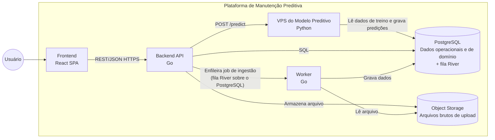

Essa separação entre Backend e o serviço do modelo existe porque os modelos preditivos são treinados e servidos em Python, enquanto o Backend é escrito em Go, linguagem que não carrega nativamente os artefatos de modelo Python. Isolar o modelo em sua própria VPS evita reescrever ou converter os modelos treinados, ao custo de uma chamada de rede entre Backend e VPS a cada predição. O uso de um único banco de dados para os dados operacionais e os dados de domínio simplifica a arquitetura, assim como o uso do próprio PostgreSQL como backend da fila de ingestão evita a operação de um broker de mensageria adicional.

---

  <Image src={Background} alt="Banner Motiva" format="png" style="position: absolute; inset: 0; width: 100%; height: 100%; object-fit: cover; z-index: 0;"/>
  <h2 style="position: relative; z-index: 1; color: white; margin: 0;">4. Diagrama de Classes</h2>

O diagrama de classes registra o modelo de domínio conceitual da plataforma, já revisado contra o schema real implementado no backend: as entidades principais e como se relacionam. As entidades identificadas são Usuário, Estação, Porta, Alarme, Manutenção, Inspeção, Predição e Arquivo Enviado. Uma Estação possui várias Portas, cada uma identificada também pela sua TAG SAP; uma Porta acumula um histórico de Alarmes, de Manutenções e de Predições ao longo do tempo; um Usuário é responsável por Inspeções; e um Arquivo Enviado origina os registros de Alarme e Manutenção que ele contém.

**Manutenção** e **Inspeção** aparecem como entidades separadas, pois representam momentos distintos do processo: a Manutenção é um registro histórico de uma intervenção já realizada, com ordem SAP, tipo, local de instalação, início, fim, duração, sintoma, causa, ação tomada e origem (manual ou upload); a Inspeção é a ordem de trabalho, com status, prioridade, data agendada e notas, além da data de conclusão quando finalizada, que ainda precisa ser executada. Uma Inspeção pode ser criada automaticamente pelo sistema quando uma Predição indica risco de falha, e também poderá ser criada manualmente por um Usuário.

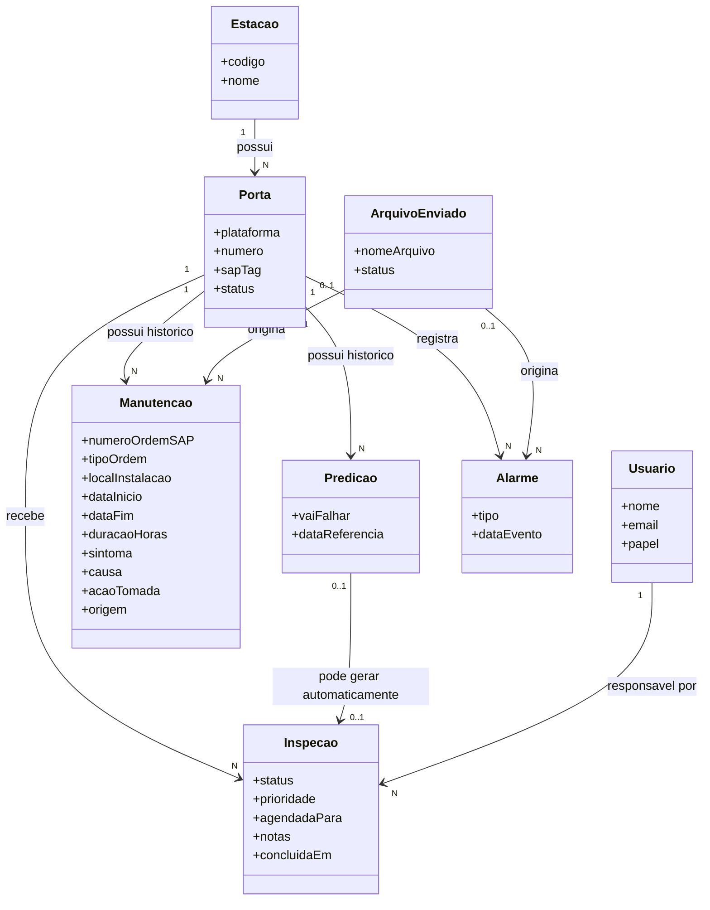

A Predição é um indicador booleano (a porta deve ou não falhar dentro do horizonte avaliado). O schema atual não guarda nenhum campo de probabilidade ou percentual de risco junto da Predição — é por isso que, quando o frontend precisa exibir um percentual, ele usa um valor de referência fixo até que o modelo passe a expor essa métrica. O banco mantém um histórico completo de Predições por Porta, mas a plataforma sempre exibe ao usuário apenas a mais recente. O Arquivo Enviado guarda apenas os metadados do upload (nome, status de processamento); os dados em si são gravados diretamente nas entidades de domínio que referenciam esse arquivo como origem.

---

  <Image src={Background} alt="Banner Motiva" format="png" style="position: absolute; inset: 0; width: 100%; height: 100%; object-fit: cover; z-index: 0;"/>
  <h2 style="position: relative; z-index: 1; color: white; margin: 0;">5. Diagrama de Casos de Uso</h2>

O diagrama de casos de uso descreve as ações disponíveis para a persona **Marta**, operadora responsável por analisar dados e planejar manutenções, único ator do sistema nesta fase, enquanto Ronaldo, o mecânico, recebe as ordens de manutenção por fora da plataforma. Diferente da primeira versão deste diagrama, que partia do [Wireframe da Sprint 2](/sprints/sprint-2/wireframe), os casos de uso abaixo foram conferidos contra o frontend e a API já implementados. Eles cobrem toda a jornada da Marta: autenticar-se na plataforma, visualizar as portas com maior probabilidade de falha, ver os alertas da última inferência, consultar detalhes de uma estação ou porta específica, consultar a timeline de uma porta e o catálogo de manutenções, registrar uma manutenção já realizada, abrir e atualizar o status de uma inspeção, cadastrar novos alarmes por planilha e disparar uma nova rodada de predição.

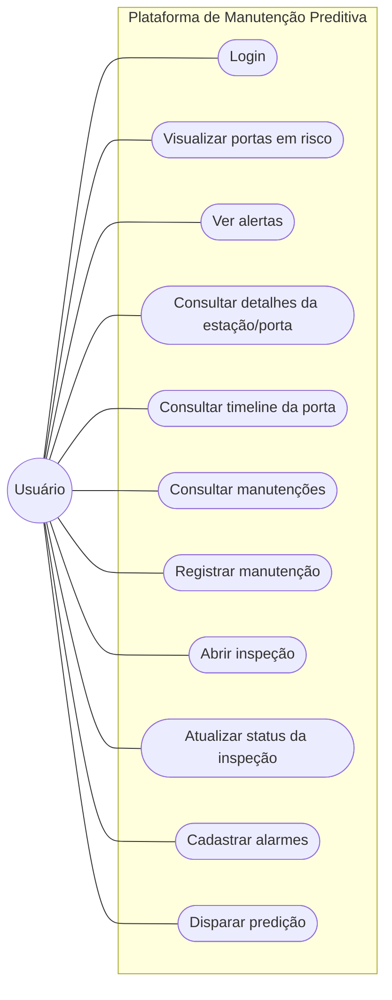

O caso de uso "Abrir inspeção" convive com a criação automática de Inspeções pelo sistema: quando uma predição indica risco de falha, o sistema já cria a ordem de inspeção correspondente, e a Marta também poderá abrir uma inspeção manualmente a partir dos detalhamentos da porta ou da tela de Inspeções, sem depender de uma predição prévia. Não existe, na API, um caso de uso de "retreino" separado do de "disparar predição": os botões **Realizar Previsão** e **Re-treinar modelo**, no frontend, acionam a mesma chamada.

---

  <Image src={Background} alt="Banner Motiva" format="png" style="position: absolute; inset: 0; width: 100%; height: 100%; object-fit: cover; z-index: 0;"/>
  <h2 style="position: relative; z-index: 1; color: white; margin: 0;">6. Diagramas de Sequência</h2>

Com o frontend e o backend já implementados em uma primeira versão, cada caso de uso do diagrama da seção anterior pode ser detalhado em um diagrama de sequência, mostrando a troca de mensagens entre Marta, o Frontend, o Backend, o PostgreSQL, a VPS do modelo preditivo, o Worker e o Object Storage. As rotas e o fluxo de cada diagrama refletem o código real, não uma proposta.

### 6.1 Login

Marta entra com e-mail e senha; o Backend valida contra o PostgreSQL e devolve um JWT, guardado pelo Frontend em `sessionStorage`.

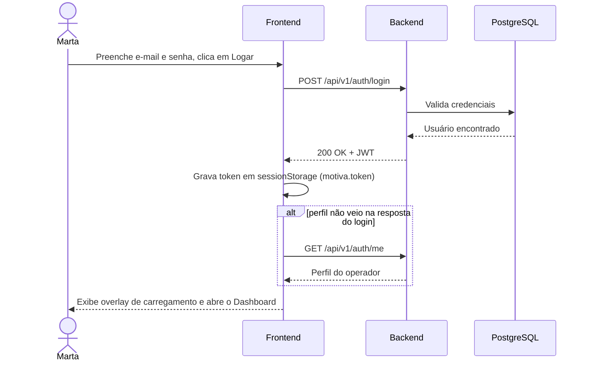

### 6.2 Visualizar portas em risco

Ao abrir o Dashboard, o Frontend busca o resumo operacional e a última inferência do modelo em paralelo, e combina o resultado com as inspeções já pré-carregadas no login.

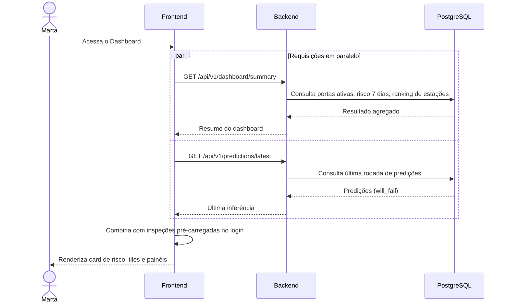

### 6.3 Ver alertas

A tela de Alertas mostra a última inferência do modelo mapeada como alerta por porta.

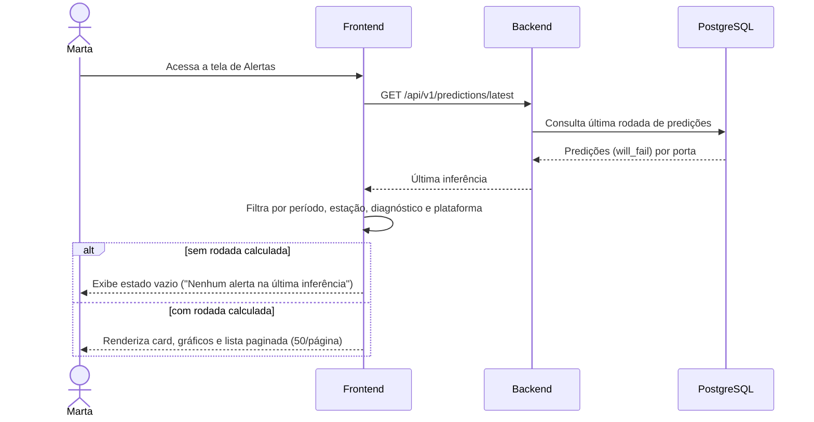

### 6.4 Consultar detalhes da estação/porta

O mapa e os dados da estação (nome, foto, código) vêm do catálogo local; só ao clicar em Acessar o Frontend busca as portas e seus status reais na API.

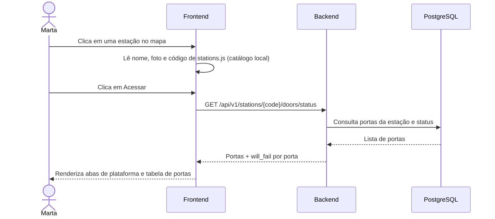

### 6.5 Consultar timeline da porta

Ao abrir os detalhamentos de uma porta, o Frontend busca a timeline consolidada; se ela não trouxer manutenções, cai para o cache local e tenta casar pelo local de instalação.

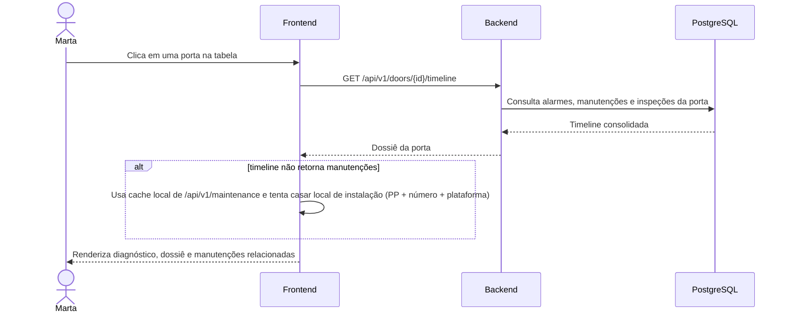

### 6.6 Consultar manutenções

O catálogo de ordens SAP entra em cache já no login, em páginas paralelas; a tela de Manutenções só busca de novo se o cache estiver vazio.

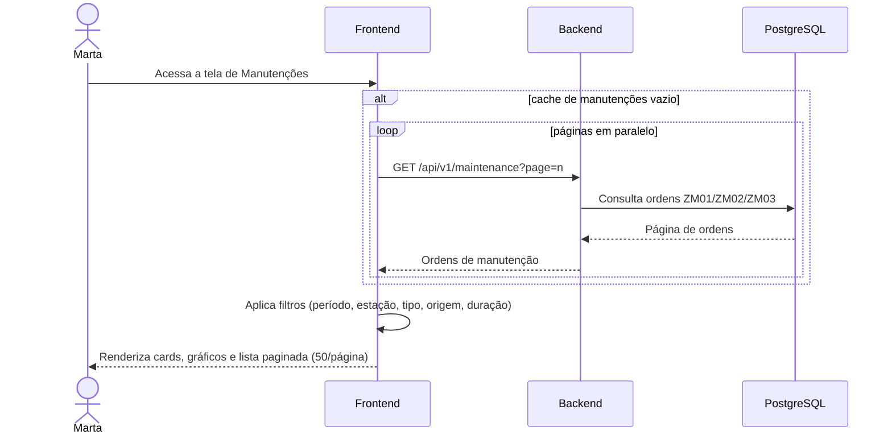

### 6.7 Registrar manutenção

A Marta registra uma manutenção já realizada, manualmente ou por planilha; o upload é assíncrono, processado pelo Worker depois de passar pelo Object Storage e pela fila.

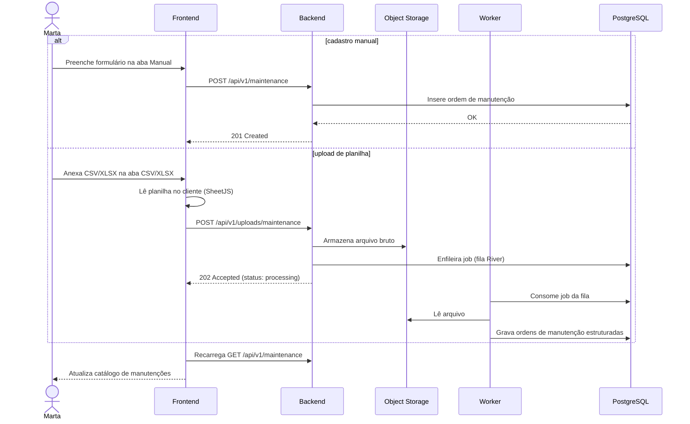

### 6.8 Abrir inspeção

A ordem de inspeção nasce pelo dossiê da porta (com prioridade alta se houver risco) ou pelo modal da própria tela de Inspeções; os dois caminhos chamam o mesmo POST.

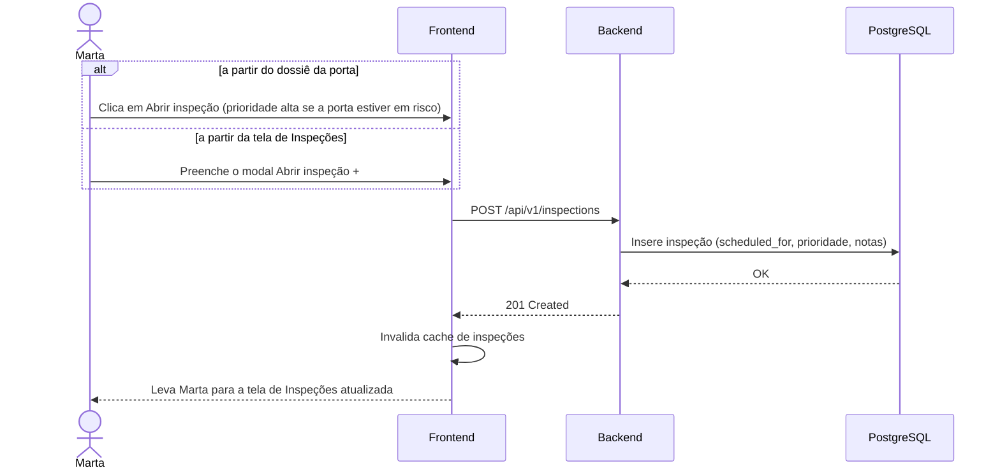

### 6.9 Atualizar status da inspeção

Trocar o seletor de status dispara um PATCH direto; o Backend valida a transição antes de gravar, e o Frontend atualiza o cache sem recarregar a página.

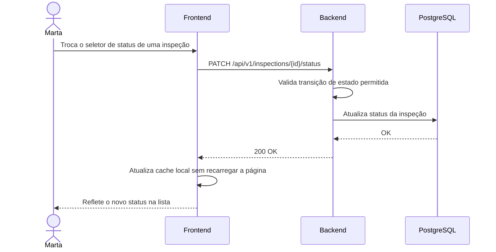

### 6.10 Cadastrar alarmes

O upload de alarmes segue o mesmo pipeline assíncrono via Worker; como não há GET de alarmes, o que a Marta vê depois é a inferência recarregada em "Ver alertas", não as linhas da planilha.

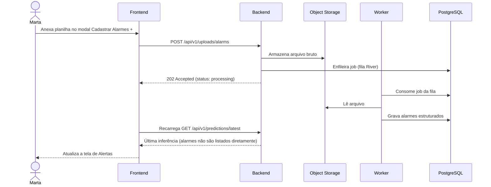

### 6.11 Disparar predição

**Realizar Previsão** e **Re-treinar modelo** chamam exatamente o mesmo endpoint; a única diferença é o texto do overlay e um carimbo local salvo pelo Frontend.

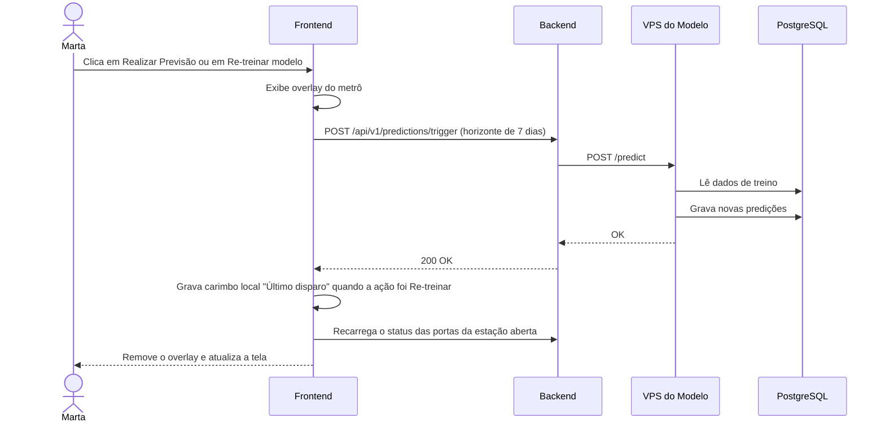

---

  <Image src={Background} alt="Banner Motiva" format="png" style="position: absolute; inset: 0; width: 100%; height: 100%; object-fit: cover; z-index: 0;"/>
  <h2 style="position: relative; z-index: 1; color: white; margin: 0;">7. Conclusão</h2>

O diagrama de **Componentes** mostrou como Frontend, Backend, Worker, banco de dados, object storage e a VPS do modelo preditivo se conectam, com destaque para a separação entre o Backend em Go e o modelo preditivo em Python, hospedado em sua própria VPS, e para o processamento assíncrono dos uploads via Worker. O diagrama de **Classes** registrou as entidades do domínio — Usuário, Estação, Porta, Alarme, Manutenção, Inspeção, Predição e Arquivo Enviado — e seus relacionamentos, distinguindo o histórico de manutenções já realizadas das inspeções ainda pendentes, e servindo de base conceitual para o schema do banco de dados. O diagrama de **Casos de Uso** formalizou as ações da persona Marta na plataforma. Por fim, os onze **Diagramas de Sequência** detalharam, caso de uso a caso de uso, a troca de mensagens real entre Marta, Frontend, Backend, PostgreSQL, VPS, Worker e Object Storage.

Juntos, os quatro diagramas cobrem a estrutura, o domínio, o comportamento e a interação em tempo de execução da solução. À medida que o projeto for se desenvolvendo, estes diagramas devem ser atualizados para continuar refletindo o sistema real.
