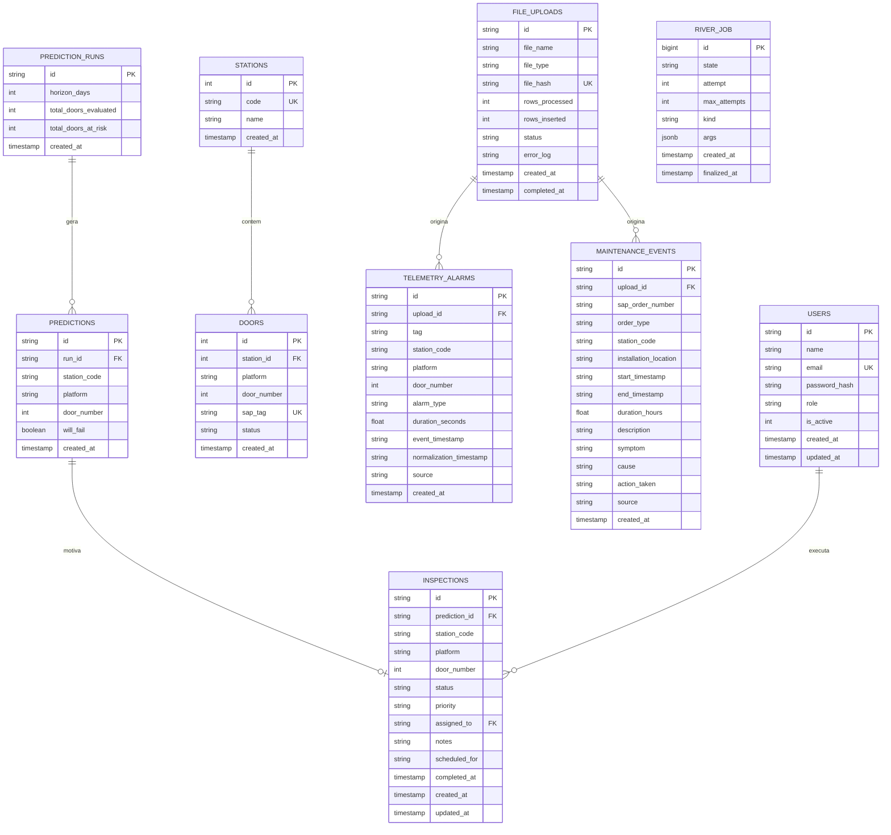

A camada de persistência do backend foi desenhada para atender aos requisitos de alta integridade, rastreabilidade operacional e baixa latência de consulta exigidos pelo monitoramento preditivo das portas de plataforma (PSD) da Linha 4-Amarela do Metrô de São Paulo.

O sistema adota o **PostgreSQL 16 do Supabase** como banco relacional principal em produção. API, Worker e ML conectam-se por TLS ao pooler gerenciado. As migrations constroem o schema e criam os usuários iniciais quando o banco está vazio; não é necessário importar dados de uma instalação anterior.

---

## 1. Fundação Tecnológica e Conectividade

A comunicação com o PostgreSQL é implementada em Go através do driver nativo `github.com/jackc/pgx/v5` operando sob a interface padrão `database/sql`. Esta abordagem combina a conformidade de interfaces do ecossistema Go com os recursos de desempenho e controle de pool do driver `pgx`.

### Configuração do Pool de Conexões

O ciclo de vida das conexões é controlado de forma determinística na inicialização da aplicação em [`cmd/api/main.go`](https://git.inteli.edu.br/graduacao/2026-2a/t16/g04/-/blob/main/src/backend/cmd/api/main.go) e [`cmd/worker/main.go`](https://git.inteli.edu.br/graduacao/2026-2a/t16/g04/-/blob/main/src/backend/cmd/worker/main.go):

| Parâmetro | Valor Configurado | Justificativa de Engenharia |
|---|---|---|
| `SetMaxOpenConns` | 5 conexões | Evita esgotar o limite de conexões do pooler gerenciado |
| `SetMaxIdleConns` | 5 conexões | Mantém conexões quentes prontas para atender requisições sem sobrecarregar a memória |
| `SetConnMaxLifetime` | 10 minutos | Renova periodicamente as conexões para evitar timeouts silenciosos impostos por firewalls intermediários |

### Isolamento pela Clean Architecture

Seguindo a regra de dependência da Clean Architecture, as entidades de domínio e os casos de uso não possuem conhecimento de tabelas SQL, drivers ou dialetos. Todas as operações de banco são expostas por meio de interfaces de portas declaradas em [`internal/usecase/port`](https://git.inteli.edu.br/graduacao/2026-2a/t16/g04/-/tree/main/src/backend/internal/usecase/port), cujas implementações concretas residem exclusivamente no pacote de adaptadores [`internal/adapter/repository`](https://git.inteli.edu.br/graduacao/2026-2a/t16/g04/-/tree/main/src/backend/internal/adapter/repository).

---

## 2. Diagrama Entidade-Relacionamento (ERD)

O modelo relacional é composto por 9 tabelas de domínio e governança operacional, além das tabelas internas mantidas pelo framework de mensageria River Queue:



---

## 3. Dicionário de Schemas e Tabelas

### 3.1 Tabela `users`

Armazena os operadores e técnicos autorizados a autenticar na plataforma via credenciais criptografadas e permissões RBAC.

| Coluna | Tipo SQL | Restrições | Finalidade Operacional |
|---|---|---|---|
| `id` | `TEXT` | `PRIMARY KEY` | Identificador único no formato UUID v4 |
| `name` | `TEXT` | `NOT NULL` | Nome completo do operador |
| `email` | `TEXT` | `NOT NULL, UNIQUE` | E-mail corporativo utilizado no login |
| `password_hash` | `TEXT` | `NOT NULL` | Hash da senha gerado com algoritmo bcrypt |
| `role` | `TEXT` | `NOT NULL, DEFAULT 'operator', CHECK(role IN ('operator'))` | Papel de autorização do usuário |
| `is_active` | `INTEGER` | `NOT NULL, DEFAULT 1, CHECK(is_active IN (0, 1))` | Indicador de usuário ativo (1) ou inativo (0) |
| `created_at` | `TIMESTAMP WITH TIME ZONE` | `NOT NULL, DEFAULT CURRENT_TIMESTAMP` | Data e hora de criação do registro |
| `updated_at` | `TIMESTAMP WITH TIME ZONE` | `NOT NULL, DEFAULT CURRENT_TIMESTAMP` | Data e hora da última atualização |

### 3.2 Tabela `stations`

Cadastra as 11 estações oficiais que compõem a Linha 4-Amarela do Metrô de São Paulo.

| Coluna | Tipo SQL | Restrições | Finalidade Operacional |
|---|---|---|---|
| `id` | `INTEGER` | `PRIMARY KEY` | Identificador numérico sequencial da estação |
| `code` | `TEXT` | `NOT NULL, UNIQUE` | Código mnemônico de 3 letras da estação (ex: `LUZ`, `PIN`, `BUT`) |
| `name` | `TEXT` | `NOT NULL` | Nome oficial da estação metroviária |
| `created_at` | `TIMESTAMP WITH TIME ZONE` | `NOT NULL, DEFAULT CURRENT_TIMESTAMP` | Data de inserção do cadastro |

### 3.3 Tabela `doors`

Representa cada uma das 528 portas de plataforma (PSD) instaladas na linha (11 estações x 2 plataformas P1/P2 x 24 portas por plataforma).

| Coluna | Tipo SQL | Restrições | Finalidade Operacional |
|---|---|---|---|
| `id` | `INTEGER` | `PRIMARY KEY` | Identificador numérico sequencial determinístico |
| `station_id` | `INTEGER` | `NOT NULL, REFERENCES stations(id) ON DELETE RESTRICT` | Chave estrangeira para a estação associada |
| `platform` | `TEXT` | `NOT NULL` | Plataforma de localização (`P1` ou `P2`) |
| `door_number` | `INTEGER` | `NOT NULL` | Número da porta na plataforma (1 a 24) |
| `sap_tag` | `TEXT` | `NOT NULL, UNIQUE` | Tag técnica oficial do SAP (ex: `SP04-6-PSD-LUZ-P1-PP01`) |
| `status` | `TEXT` | `NOT NULL, DEFAULT 'active'` | Estado operacional da porta |
| `created_at` | `TIMESTAMP WITH TIME ZONE` | `NOT NULL, DEFAULT CURRENT_TIMESTAMP` | Data de cadastro no sistema |

A unicidade física de cada porta é assegurada pela constraint composta `uq_station_platform_door UNIQUE (station_id, platform, door_number)`.

### 3.4 Tabela `file_uploads`

Registra a trilha de auditoria e o estado do ciclo de vida de cada lote de telemetria ou ordens de manutenção submetido via API HTTP.

| Coluna | Tipo SQL | Restrições | Finalidade Operacional |
|---|---|---|---|
| `id` | `TEXT` | `PRIMARY KEY` | Identificador único UUID do upload |
| `file_name` | `TEXT` | `NOT NULL` | Nome original do arquivo enviado |
| `file_type` | `TEXT` | `NOT NULL` | Tipo do arquivo (`alarms` ou `maintenance`) |
| `file_hash` | `TEXT` | `UNIQUE` | Hash SHA-256 do conteúdo bruto para verificação de duplicidade |
| `rows_processed` | `INTEGER` | `NOT NULL, DEFAULT 0` | Quantidade de registros lidos do arquivo |
| `rows_inserted` | `INTEGER` | `NOT NULL, DEFAULT 0` | Quantidade de registros gravados com sucesso no banco |
| `status` | `TEXT` | `NOT NULL, DEFAULT 'processing'` | Estado do processamento (`processing`, `completed`, `failed`) |
| `error_log` | `TEXT` | Permite nulo | Mensagens de diagnóstico em caso de falha de validação ou parsing |
| `created_at` | `TIMESTAMP WITH TIME ZONE` | `NOT NULL, DEFAULT CURRENT_TIMESTAMP` | Timestamp do início da recepção do upload |
| `completed_at` | `TIMESTAMP WITH TIME ZONE` | Permite nulo | Timestamp da finalização da ingestão assíncrona |

### 3.5 Tabela `telemetry_alarms`

Armazena a série temporal de alarmes gerados pelos sensores das portas de plataforma, alimentando tanto a análise preditiva quanto os painéis operacionais.

| Coluna | Tipo SQL | Restrições | Finalidade Operacional |
|---|---|---|---|
| `id` | `TEXT` | `PRIMARY KEY` | Identificador UUID do alarme |
| `upload_id` | `TEXT` | `REFERENCES file_uploads(id) ON DELETE SET NULL` | Vínculo com o lote de ingestão de origem |
| `tag` | `TEXT` | `NOT NULL` | Tag técnica identificadora do ponto de monitoramento |
| `station_code` | `TEXT` | `NOT NULL` | Código mnemônico da estação |
| `platform` | `TEXT` | Permite nulo | Plataforma correspondente |
| `door_number` | `INTEGER` | Permite nulo | Número da porta associada |
| `alarm_type` | `TEXT` | `NOT NULL` | Tipologia técnica do evento de alarme |
| `duration_seconds` | `REAL` | `NOT NULL, DEFAULT 0` | Duração do estado de alarme em segundos |
| `event_timestamp` | `TEXT` | `NOT NULL` | Timestamp ISO 8601 da ocorrência do alarme |
| `normalization_timestamp` | `TEXT` | Permite nulo | Timestamp ISO 8601 do retorno às condições normais |
| `source` | `TEXT` | `NOT NULL, DEFAULT 'spreadsheet'` | Origem do dado (`spreadsheet` ou `stream`) |
| `created_at` | `TIMESTAMP WITH TIME ZONE` | `NOT NULL, DEFAULT CURRENT_TIMESTAMP` | Data de persistência no PostgreSQL |

### 3.6 Tabela `maintenance_events`

Registra o histórico de intervenções de manutenção física executadas nas portas (ex: ordens corretivas ZM03 e preventivas).

| Coluna | Tipo SQL | Restrições | Finalidade Operacional |
|---|---|---|---|
| `id` | `TEXT` | `PRIMARY KEY` | Identificador UUID do evento de manutenção |
| `upload_id` | `TEXT` | `REFERENCES file_uploads(id) ON DELETE SET NULL` | Vínculo com a planilha de origem |
| `sap_order_number` | `TEXT` | Permite nulo | Número oficial da ordem no SAP |
| `order_type` | `TEXT` | `NOT NULL` | Tipo da ordem de manutenção (ex: `ZM03`) |
| `station_code` | `TEXT` | Permite nulo | Estação onde ocorreu o reparo |
| `installation_location` | `TEXT` | Permite nulo | Local físico de instalação especificado na ordem |
| `start_timestamp` | `TEXT` | `NOT NULL` | Data e hora do início da intervenção |
| `end_timestamp` | `TEXT` | Permite nulo | Data e hora do encerramento da intervenção |
| `duration_hours` | `REAL` | `NOT NULL, DEFAULT 0` | Duração calculada do reparo em horas |
| `description` | `TEXT` | Permite nulo | Descrição textual do chamado |
| `symptom` | `TEXT` | Permite nulo | Sintoma observado pela equipe técnica |
| `cause` | `TEXT` | Permite nulo | Causa raiz identificada na manutenção |
| `action_taken` | `TEXT` | Permite nulo | Ação corretiva realizada na porta |
| `source` | `TEXT` | `NOT NULL, DEFAULT 'spreadsheet'` | Origem do registro |
| `created_at` | `TIMESTAMP WITH TIME ZONE` | `NOT NULL, DEFAULT CURRENT_TIMESTAMP` | Data de persistência |

### 3.7 Tabela `prediction_runs`

Consolida os metadados de cada lote de inferência gerado pelo modelo preditivo de Machine Learning.

| Coluna | Tipo SQL | Restrições | Finalidade Operacional |
|---|---|---|---|
| `id` | `TEXT` | `PRIMARY KEY` | Identificador UUID da rodada preditiva |
| `horizon_days` | `INTEGER` | `NOT NULL, DEFAULT 7` | Horizonte temporal avaliado em dias (padrão: 7 dias) |
| `threshold_used` | `REAL` | Permite nulo, valor entre 0 e 1 | Limiar efetivamente aplicado na rodada, preservado para auditoria mesmo após mudanças de configuração |
| `model_version` | `TEXT` | `NOT NULL, DEFAULT ''` | Versão do artefato responsável pelos resultados |
| `is_experiment` | `BOOLEAN` | `NOT NULL, DEFAULT FALSE` | Separa cenários do laboratório das rodadas que alimentam a operação |
| `published_at` | `TIMESTAMP WITH TIME ZONE` | Permite nulo | Registra quando a engenharia adotou a rodada como oficial; permanece nulo enquanto o cenário está isolado |
| `total_doors_evaluated` | `INTEGER` | `NOT NULL, DEFAULT 0` | Total de portas avaliadas na execução |
| `total_doors_at_risk` | `INTEGER` | `NOT NULL, DEFAULT 0` | Contagem total de portas com probabilidade de falha |
| `created_at` | `TIMESTAMP WITH TIME ZONE` | `NOT NULL, DEFAULT CURRENT_TIMESTAMP` | Data e hora de execução da predição |

### 3.8 Tabela `predictions`

Detalha a classificação preditiva de cada porta de plataforma avaliada em uma determinada rodada.

| Coluna | Tipo SQL | Restrições | Finalidade Operacional |
|---|---|---|---|
| `id` | `TEXT` | `PRIMARY KEY` | Identificador UUID da predição individual |
| `run_id` | `TEXT` | `NOT NULL, REFERENCES prediction_runs(id) ON DELETE CASCADE` | Vínculo com a execução de predição correspondente |
| `station_code` | `TEXT` | `NOT NULL` | Código da estação da porta |
| `platform` | `TEXT` | `NOT NULL` | Plataforma da porta |
| `door_number` | `INTEGER` | `NOT NULL` | Número da porta avaliada |
| `will_fail` | `BOOLEAN` | `NOT NULL, DEFAULT FALSE` | Flag binária indicando se há risco iminente de falha |
| `probability` | `REAL` | Permite nulo, valor entre 0 e 1 | Probabilidade bruta devolvida pelo modelo; permanece nula nas rodadas legadas que só armazenavam a classe |
| `created_at` | `TIMESTAMP WITH TIME ZONE` | `NOT NULL, DEFAULT CURRENT_TIMESTAMP` | Data de gravação |

### 3.9 Tabela `inspections`

Gerencia o ciclo de vida das ordens de inspeção preventiva em campo geradas a partir de predições ou criadas manualmente por operadores.

| Coluna | Tipo SQL | Restrições | Finalidade Operacional |
|---|---|---|---|
| `id` | `TEXT` | `PRIMARY KEY` | Identificador UUID da inspeção |
| `prediction_id` | `TEXT` | `REFERENCES predictions(id) ON DELETE SET NULL` | Predição originária que motivou a inspeção |
| `station_code` | `TEXT` | `NOT NULL` | Código da estação |
| `platform` | `TEXT` | `NOT NULL` | Plataforma da porta a ser inspecionada |
| `door_number` | `INTEGER` | `NOT NULL` | Número da porta alvo da inspeção |
| `status` | `TEXT` | `NOT NULL, DEFAULT 'pending', CHECK(status IN ('pending', 'in_progress', 'completed', 'canceled'))` | Estado da ordem de serviço |
| `priority` | `TEXT` | `NOT NULL, DEFAULT 'high', CHECK(priority IN ('low', 'medium', 'high', 'critical'))` | Nível de urgência da ação preventiva |
| `assigned_to` | `TEXT` | `REFERENCES users(id) ON DELETE SET NULL` | Operador técnico atribuído ao atendimento |
| `notes` | `TEXT` | Permite nulo | Parecer técnico e anotações de campo |
| `scheduled_for` | `TEXT` | Permite nulo | Data prevista para a realização da vistoria |
| `completed_at` | `TIMESTAMP WITH TIME ZONE` | Permite nulo | Timestamp de conclusão da inspeção |
| `created_at` | `TIMESTAMP WITH TIME ZONE` | `NOT NULL, DEFAULT CURRENT_TIMESTAMP` | Data de abertura da ordem |
| `updated_at` | `TIMESTAMP WITH TIME ZONE` | `NOT NULL, DEFAULT CURRENT_TIMESTAMP` | Data da última alteração de estado |

---

## 4. Estratégia de Índices e Performance de Consultas

Para assegurar respostas em poucos milissegundos nas rotas do dashboard e consultas operacionais sob volumes elevados de alarmes e telemetria, foram desenhados índices estratégicos para cada padrão de acesso:

| Nome do Índice | Tabela Alvo | Colunas Indexadas | Finalidade e Impacto na Performance |
|---|---|---|---|
| `idx_file_uploads_hash` | `file_uploads` | `file_hash` (`UNIQUE`) | Garante idempotência absoluta no upload de arquivos, interceptando duplicatas no banco |
| `idx_users_email` | `users` | `email` | Acelera a consulta de autenticação no login |
| `idx_doors_station` | `doors` | `station_id` | Otimiza junções relacionais entre estações e suas respectivas portas de plataforma |
| `idx_doors_sap_tag` | `doors` | `sap_tag` | Viabiliza busca direta instantânea por tag técnica corporativa de equipamento |
| `idx_telemetry_alarms_station_time` | `telemetry_alarms` | `(station_code, event_timestamp)` | Acelera filtros temporais por estação e agregações de volume histórico |
| `idx_telemetry_alarms_upload_id` | `telemetry_alarms` | `upload_id` | Suporta deleções atômicas e consultas de auditoria associadas a um lote |
| `idx_maintenance_events_order_time` | `maintenance_events` | `(order_type, start_timestamp)` | Otimiza relatórios de manutenção preventiva e corretiva por período |
| `idx_maintenance_events_upload_id` | `maintenance_events` | `upload_id` | Viabiliza rastreamento direto entre ordens importadas e a planilha de origem |
| `idx_predictions_run_id` | `predictions` | `run_id` | Permite recuperação em lote de todas as classificações de uma rodada preditiva |
| `idx_predictions_will_fail` | `predictions` | `(run_id, will_fail)` | Viabiliza o cálculo imediato do card de portas em risco no painel operacional |
| `idx_predictions_door_history` | `predictions` | `(station_code, platform, door_number, created_at DESC)` | Recupera a evolução preditiva de uma porta sem varrer resultados de outras estações e plataformas |
| `idx_prediction_runs_published` | `prediction_runs` | `(published_at DESC) WHERE is_experiment = FALSE` | Encontra a configuração oficial mais recente sem misturar cenários de laboratório |
| `idx_prediction_runs_experiments` | `prediction_runs` | `(created_at DESC) WHERE is_experiment = TRUE` | Lista rapidamente os testes ainda disponíveis para comparação e promoção |
| `idx_inspections_status` | `inspections` | `status` | Agiliza a contagem de inspeções pendentes e em andamento para o dashboard |
| `idx_inspections_station_door` | `inspections` | `(station_code, platform, door_number)` | Acelera a recuperação da timeline histórica de eventos por porta individual |

---

## 5. Estratégia de Migrações Versionadas com `golang-migrate`

A evolução do esquema do banco de dados é governada de maneira estrita através do pacote `github.com/golang-migrate/migrate/v4`.

### Estrutura de Arquivos

Todas as migrações residem no diretório [`src/backend/migrations`](https://git.inteli.edu.br/graduacao/2026-2a/t16/g04/-/tree/main/src/backend/migrations) seguindo o padrão numérico sequencial de 6 dígitos:

```
migrations/
├── 000001_create_users_table.up.sql
├── 000001_create_users_table.down.sql
├── 000002_seed_initial_user.up.sql
├── 000002_seed_initial_user.down.sql
├── 000003_create_stations_and_doors.up.sql
├── 000003_create_stations_and_doors.down.sql
├── 000004_create_uploads_and_alarms.up.sql
├── 000004_create_uploads_and_alarms.down.sql
├── 000005_create_maintenance_events.up.sql
├── 000005_create_maintenance_events.down.sql
├── 000006_create_prediction_runs_and_predictions.up.sql
├── 000006_create_prediction_runs_and_predictions.down.sql
├── 000007_create_inspections.up.sql
├── 000007_create_inspections.down.sql
├── 000008_seed_stations_and_doors.up.sql
├── 000008_seed_stations_and_doors.down.sql
├── 000009_add_file_hash_to_uploads.up.sql
├── 000009_add_file_hash_to_uploads.down.sql
├── 000010_drop_priority_from_inspections.up.sql
├── 000010_drop_priority_from_inspections.down.sql
├── 000011_add_engineer_role_and_user.up.sql
├── 000011_add_engineer_role_and_user.down.sql
├── 000012_create_mlops_tables.up.sql
├── 000012_create_mlops_tables.down.sql
├── 000013_add_prediction_history_metadata.up.sql
├── 000013_add_prediction_history_metadata.down.sql
├── 000014_add_prediction_experiments.up.sql
└── 000014_add_prediction_experiments.down.sql
```

### Execução Automatizada e Controle de Ambiente

A execução das migrações ocorre durante a inicialização do executável `cmd/api`, sob controle da variável de ambiente `RUN_MIGRATIONS`:

1. A função `checkDatabaseConnection` verifica a disponibilidade do PostgreSQL através de ping com timeout de 5 segundos;
2. Se `RUN_MIGRATIONS=true`, a função `runMigrations` instancia o driver PostgreSQL do `golang-migrate` sobre o pool de conexões ativo;
3. O migrador aplica todas as versões pendentes em ordem crescente e grava a versão atual na tabela interna `schema_migrations`;
4. Se o esquema já estiver na versão mais recente, o erro benigno `migrate.ErrNoChange` é interceptado silenciosamente, permitindo que a API suba normalmente;
5. Se `RUN_MIGRATIONS=false`, o passo é pulado, permitindo que instâncias secundárias ou réplicas de leitura subam sem concorrer pelo lock de migração.

### Seeds Determinísticos

As migrações incluem os dados fundamentais para a operação do sistema metroviário:
- **Operador Padrão (`000002`):** inserção do usuário inicial com credenciais criptografadas via bcrypt;
- **Estações e Portas (`000008`):** geração procedural via SQL das 11 estações e das 528 portas de plataforma correspondentes, construindo suas tags SAP de forma determinística com cláusulas `ON CONFLICT (id) DO NOTHING`.

---

## 6. Transações ACID e o Padrão Unit of Work

Para coordenar mutações que abrangem múltiplos repositórios com garantia de atomicidade, o backend implementa o padrão **Unit of Work** em [`internal/adapter/repository/unit_of_work.go`](https://git.inteli.edu.br/graduacao/2026-2a/t16/g04/-/blob/main/src/backend/internal/adapter/repository/unit_of_work.go).

### Implementação do `PostgresUnitOfWork`

O adaptador gerencia uma transação `sql.Tx` nativa através do método `Do`:

```go
func (u *PostgresUnitOfWork) Do(ctx context.Context, fn func(store port.UnitOfWorkStore) error) error {
	tx, err := u.db.BeginTx(ctx, nil)
	if err != nil {
		return fmt.Errorf("falha ao iniciar transacao: %w", err)
	}

	defer func() {
		_ = tx.Rollback()
	}()

	store := &postgresUnitOfWorkStore{tx: tx}

	if err := fn(store); err != nil {
		return err
	}

	if err := tx.Commit(); err != nil {
		return fmt.Errorf("falha ao confirmar transacao: %w", err)
	}

	return nil
}
```

### Garantias no Fluxo de Ingestão e Agendamento

O Unit of Work desempenha papel crucial nos casos de uso de ingestão de arquivos ([`usecase.IngestAlarmsUseCase`](https://git.inteli.edu.br/graduacao/2026-2a/t16/g04/-/blob/main/src/backend/internal/usecase/ingest_alarms_usecase.go)):

1. **Atomicidade:** a criação do registro na tabela `file_uploads` e o enfileiramento do job transacional no River compartilham a mesma transação no PostgreSQL;
2. **Consistência:** se a persistência do job falhar, a transação sofre rollback e o registro de upload não é persistido, eliminando estados inconsistentes no sistema;
3. **Isolamento:** leituras concorrentes só visualizam o upload após o commit completo da transação;
4. **Durabilidade:** uma vez confirmado o commit, tanto os metadados quanto o job de ingestão estão salvos nos logs de transação (WAL) do PostgreSQL.

### Inserção em Lotes Otimizada (`BatchInsertAlarms`)

Durante a etapa de processamento assíncrono executada pelo worker, a gravação de centenas ou milhares de alarmes extraídos de planilhas é feita por lotes particionados de 50 registros (`chunkSize = 50`). Cada lote gera uma única instrução `INSERT INTO ... VALUES (...)` parametrizada, minimizando o overhead de rede e round-trips com o banco de dados.

### Reconciliação de Falhas

Em caso de reinicialização abrupta de processos, o método `ReconcileStaleUploads` identifica e atualiza uploads presos no estado `processing` para `failed`, registrando o motivo no campo `error_log` e viabilizando o reenvio da planilha pela operação metroviária.
