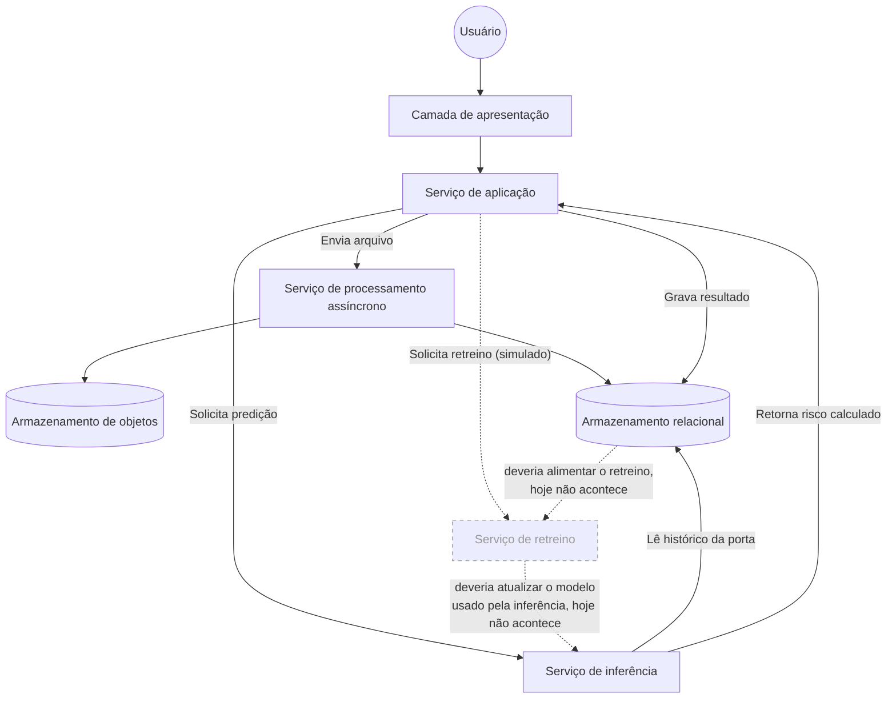

import { Image } from 'astro:assets';
import Background from '../../../../assets/sprints/sprint1/background_title.png';

  <Image src={Background} alt="Banner Motiva" format="png" style="position: absolute; inset: 0; width: 100%; height: 100%; object-fit: cover; z-index: 0;"/>
  <h2 style="position: relative; z-index: 1; color: white; margin: 0;">1. Por que uma arquitetura agnóstica</h2>

Antes de nomear qualquer tecnologia, vale descrever a solução pelo que ela faz e não pelo que ela usa. Essa ordem não é uma formalidade; Descrever o papel antes da ferramenta é o que permite comparar alternativas de tecnologia com critério depois, em vez de escolher só por familiaridade e justificar a escolha depois. Isso também é o que torna a arquitetura mais estável que a implementação por trás dela. Os papéis de um sistema continuam fazendo sentido mesmo que uma parte específica seja trocada por outra equivalente, e mesmo quando, como no caso do retreino descrito mais adiante neste documento, a implementação por trás de um papel ainda está incompleta.

Essa separação já existe no código do backend, só que em outro nível. O ADR de Clean Architecture do projeto separa a regra de negócio dos detalhes técnicos (banco, framework) por trás de interfaces, justamente para que trocar um detalhe de infraestrutura não obrigue a alterar a regra de negócio. A visão agnóstica aplica o mesmo princípio um nível acima, na arquitetura como um todo e não só dentro do código.

Um exemplo disso sera o serviço de processamento assíncrono da plataforma, que hoje roda em uma fila implementada em cima do próprio PostgreSQL. Se o volume de uploads crescer e essa fila for substituída por um broker dedicado, a frase "existe um serviço de processamento assíncrono que trata arquivos grandes sem travar o resto do sistema" continua verdadeira sem nenhuma alteração. A técnologia pode mudar mas não o papel que ela cumpre.

---

  <Image src={Background} alt="Banner Motiva" format="png" style="position: absolute; inset: 0; width: 100%; height: 100%; object-fit: cover; z-index: 0;"/>
  <h2 style="position: relative; z-index: 1; color: white; margin: 0;">2. Continuando da Sprint 3</h2>

A Arquitetura UML da Sprint 3 descreveu a plataforma tendo um Frontend, Backend, banco de dados e o serviço de modelo, junto com os casos de uso e o passo a passo de cada tela. Este documento mostra como o sistema evoluiu daquele ponto até aqui, mais especificamente para o caminho que o dado percorre, e apontando o que já funciona de ponta a ponta e o que ainda é só uma simulação na interface.

A plataforma tem quatro papéis principais. Uma camada de apresentação, que o usuário acessa; um serviço de aplicação, que concentra as regras de negócio; um serviço de processamento assíncrono, que trata arquivos grandes sem travar o resto do sistema; e um serviço de inferência, separado por resolver um problema diferente (aprendizado de máquina, não regra de negócio). Duas formas de armazenamento apoiam isso, um armazenamento relacional, para o dado estruturado, e um armazenamento de objetos, para os arquivos que vem com dados brutos antes de serem interpretados.

---

  <Image src={Background} alt="Banner Motiva" format="png" style="position: absolute; inset: 0; width: 100%; height: 100%; object-fit: cover; z-index: 0;"/>
  <h2 style="position: relative; z-index: 1; color: white; margin: 0;">3. Diagrama de Fluxo de Dados</h2>

Esse diagrama mostra três caminhos que o dado percorre na plataforma. Os dois primeiros com linha contínua já funcionam de verdade, testados com dados reais. O terceiro com linha tracejada mostra o caminho que o retreino do modelo deveria seguir. Por enquanto ele existe como botão na tela, sem essas ligações por trás.

