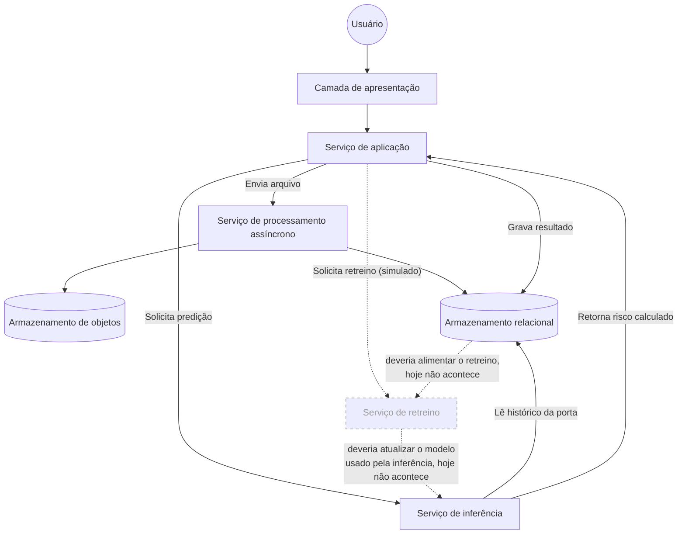

import { Image } from 'astro:assets';
import Background from '../../../../assets/sprints/sprint1/background_title.png';

  <Image src={Background} alt="Banner Motiva" format="png" style="position: absolute; inset: 0; width: 100%; height: 100%; object-fit: cover; z-index: 0;"/>
  <h2 style="position: relative; z-index: 1; color: white; margin: 0;">1. Por que uma arquitetura agnóstica</h2>

Antes de nomear qualquer tecnologia, vale descrever a solução pelo que ela faz e não pelo que ela usa. Essa ordem não é uma formalidade; Descrever o papel antes da ferramenta é o que permite comparar alternativas de tecnologia com critério depois, em vez de escolher só por familiaridade e justificar a escolha depois. Isso também é o que torna a arquitetura mais estável que a implementação por trás dela. Os papéis de um sistema continuam fazendo sentido mesmo que uma parte específica seja trocada por outra equivalente, e mesmo quando, como no caso do retreino descrito mais adiante neste documento, a implementação por trás de um papel ainda está incompleta.

Essa separação já existe no código do backend, só que em outro nível. O ADR de Clean Architecture do projeto separa a regra de negócio dos detalhes técnicos (banco, framework) por trás de interfaces, justamente para que trocar um detalhe de infraestrutura não obrigue a alterar a regra de negócio. A visão agnóstica aplica o mesmo princípio um nível acima, na arquitetura como um todo e não só dentro do código.

Um exemplo disso sera o serviço de processamento assíncrono da plataforma, que hoje roda em uma fila implementada em cima do próprio PostgreSQL. Se o volume de uploads crescer e essa fila for substituída por um broker dedicado, a frase "existe um serviço de processamento assíncrono que trata arquivos grandes sem travar o resto do sistema" continua verdadeira sem nenhuma alteração. A técnologia pode mudar mas não o papel que ela cumpre.

---

  <Image src={Background} alt="Banner Motiva" format="png" style="position: absolute; inset: 0; width: 100%; height: 100%; object-fit: cover; z-index: 0;"/>
  <h2 style="position: relative; z-index: 1; color: white; margin: 0;">2. Continuando da Sprint 3</h2>

A Arquitetura UML da Sprint 3 descreveu a plataforma tendo um Frontend, Backend, banco de dados e o serviço de modelo, junto com os casos de uso e o passo a passo de cada tela. Este documento mostra como o sistema evoluiu daquele ponto até aqui, mais especificamente para o caminho que o dado percorre, e apontando o que já funciona de ponta a ponta e o que ainda é só uma simulação na interface.

A plataforma tem quatro papéis principais. Uma camada de apresentação, que o usuário acessa; um serviço de aplicação, que concentra as regras de negócio; um serviço de processamento assíncrono, que trata arquivos grandes sem travar o resto do sistema; e um serviço de inferência, separado por resolver um problema diferente (aprendizado de máquina, não regra de negócio). Duas formas de armazenamento apoiam isso, um armazenamento relacional, para o dado estruturado, e um armazenamento de objetos, para os arquivos que vem com dados brutos antes de serem interpretados.

---

  <Image src={Background} alt="Banner Motiva" format="png" style="position: absolute; inset: 0; width: 100%; height: 100%; object-fit: cover; z-index: 0;"/>
  <h2 style="position: relative; z-index: 1; color: white; margin: 0;">3. Diagrama de Fluxo de Dados</h2>

O diagrama mostra três caminhos que o dado percorre na plataforma. Os dois primeiros (linha contínua) já funcionam de verdade, testados contra dado real. O terceiro (linha tracejada) mostra o caminho que o retreino do modelo **deveria** seguir — hoje ele existe só como botão na tela, sem essas ligações por trás.

---

  <Image src={Background} alt="Banner Motiva" format="png" style="position: absolute; inset: 0; width: 100%; height: 100%; object-fit: cover; z-index: 0;"/>
  <h2 style="position: relative; z-index: 1; color: white; margin: 0;">4. Explicando cada caminho</h2>

**Enviar um arquivo novo**: a pessoa usuária manda uma planilha pela tela. O serviço de aplicação não processa esse arquivo na hora — ele passa a responsabilidade pro serviço de processamento assíncrono, que guarda o arquivo original no armazenamento de objetos e, depois de ler e entender o conteúdo, grava as linhas já organizadas no armazenamento relacional. Esse passo a mais existe pra um arquivo grande não travar a tela de quem está usando a plataforma.

**Pedir uma predição**: o serviço de aplicação passa a porta pro serviço de inferência. Esse serviço busca sozinho, no armazenamento relacional, o histórico que precisa daquela porta, calcula o risco, e devolve a resposta. Quem grava esse resultado de volta no banco é o serviço de aplicação, não o serviço de inferência.

**Pedir um retreino (o que falta)**: o botão de retreino existe na tela e responde alguma coisa, mas por trás dele faltam as duas ligações desenhadas tracejadas no diagrama — ele não lê o dado mais recente do armazenamento, e não existe nenhum caminho que leve um modelo novo até o serviço de inferência. Hoje, apertar esse botão devolve um resultado fixo, de demonstração, sem processar nenhum dado real.

---

  <Image src={Background} alt="Banner Motiva" format="png" style="position: absolute; inset: 0; width: 100%; height: 100%; object-fit: cover; z-index: 0;"/>
  <h2 style="position: relative; z-index: 1; color: white; margin: 0;">5. Isso pode mudar</h2>

Este documento descreve o fluxo como ele está hoje, não uma meta final. Se o time decidir fechar as lacunas do retreino, o diagrama e as explicações acima devem ser atualizados pra refletir a mudança — do mesmo jeito que os diagramas da Sprint 3 foram sendo ajustados conforme decisões eram validadas.

Uma evolução real já está em andamento: uma nova versão do serviço de retreino foi commitada numa branch separada, ainda não integrada, trazendo execução assíncrona de verdade (com retomada em caso de falha), versionamento do modelo com troca sem precisar reconstruir o container, e cálculo real de drift a partir da distribuição das features das portas ativas. A lacuna que permanece, mesmo nessa versão nova, é a mesma apontada no diagrama: a fonte de dado do treino ainda é um retrato histórico fixo, não o dado mais recente do armazenamento relacional. Quando essa branch for validada e integrada, este documento deve ser atualizado de novo.