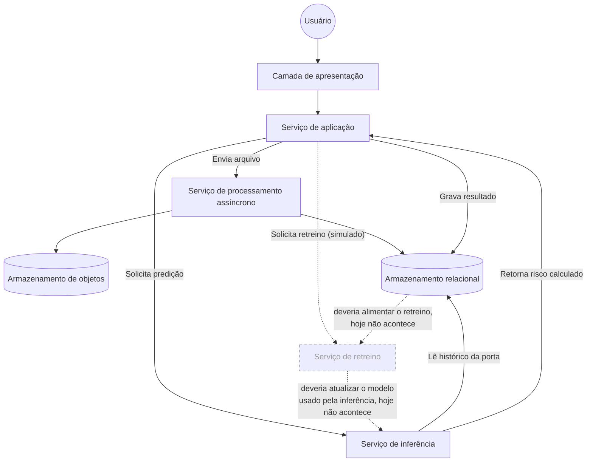

import { Image } from 'astro:assets';
import Background from '../../../../assets/sprints/sprint1/background_title.png';
import DiagramaComponentes from '../../../../assets/sprints/sprint4/diagrama_componentes_uml.png';

  <Image src={Background} alt="Banner Motiva" format="png" style="position: absolute; inset: 0; width: 100%; height: 100%; object-fit: cover; z-index: 0;"/>
  <h2 style="position: relative; z-index: 1; color: white; margin: 0;">1. Por que uma arquitetura agnóstica</h2>

Antes de nomear qualquer tecnologia, vale descrever a solução pelo que ela faz e não pelo que ela usa. Essa ordem não é uma formalidade; Descrever o papel antes da ferramenta é o que permite comparar alternativas de tecnologia com critério depois, em vez de escolher só por familiaridade e justificar a escolha depois. Isso também é o que torna a arquitetura mais estável que a implementação por trás dela. Os papéis de um sistema continuam fazendo sentido mesmo que uma parte específica seja trocada por outra equivalente, e mesmo quando, como no caso do retreino descrito mais adiante neste documento, a implementação por trás de um papel ainda está incompleta.

Essa separação já existe no código do backend, só que em outro nível. O ADR de Clean Architecture do projeto separa a regra de negócio dos detalhes técnicos (banco, framework) por trás de interfaces, justamente para que trocar um detalhe de infraestrutura não obrigue a alterar a regra de negócio. A visão agnóstica aplica o mesmo princípio um nível acima, na arquitetura como um todo e não só dentro do código.

Um exemplo disso sera o serviço de processamento assíncrono da plataforma, que hoje roda em uma fila implementada em cima do próprio PostgreSQL. Se o volume de uploads crescer e essa fila for substituída por um broker dedicado, a frase "existe um serviço de processamento assíncrono que trata arquivos grandes sem travar o resto do sistema" continua verdadeira sem nenhuma alteração. A técnologia pode mudar mas não o papel que ela cumpre.

---

  <Image src={Background} alt="Banner Motiva" format="png" style="position: absolute; inset: 0; width: 100%; height: 100%; object-fit: cover; z-index: 0;"/>
  <h2 style="position: relative; z-index: 1; color: white; margin: 0;">2. Continuando da Sprint 3</h2>

A Arquitetura UML da Sprint 3 descreveu a plataforma tendo um Frontend, Backend, banco de dados e o serviço de modelo, junto com os casos de uso e o passo a passo de cada tela. Este documento mostra como o sistema evoluiu daquele ponto até aqui, mais especificamente para o caminho que o dado percorre, e apontando o que já funciona de ponta a ponta e o que ainda é só uma simulação na interface.

A plataforma tem quatro papéis principais. Uma camada de apresentação, que o usuário acessa; um serviço de aplicação, que concentra as regras de negócio; um serviço de processamento assíncrono, que trata arquivos grandes sem travar o resto do sistema; e um serviço de inferência, separado por resolver um problema diferente (aprendizado de máquina, não regra de negócio). Duas formas de armazenamento apoiam isso, um armazenamento relacional, para o dado estruturado, e um armazenamento de objetos, para os arquivos que vem com dados brutos antes de serem interpretados.

---

  <Image src={Background} alt="Banner Motiva" format="png" style="position: absolute; inset: 0; width: 100%; height: 100%; object-fit: cover; z-index: 0;"/>
  <h2 style="position: relative; z-index: 1; color: white; margin: 0;">3. Diagrama de Fluxo de Dados</h2>

Esse diagrama mostra três caminhos que o dado percorre na plataforma. Os dois primeiros com linha contínua já funcionam de verdade, testados com dados reais. O terceiro com linha tracejada mostra o caminho que o retreino do modelo deveria seguir. Por enquanto ele existe como botão na tela, sem essas ligações por trás.

---

  <Image src={Background} alt="Banner Motiva" format="png" style="position: absolute; inset: 0; width: 100%; height: 100%; object-fit: cover; z-index: 0;"/>
  <h2 style="position: relative; z-index: 1; color: white; margin: 0;">4. Explicando cada caminho</h2>

**Enviar um arquivo novo**: O usuário manda uma planilha pela tela. O serviço de aplicação não processa esse arquivo na hora, ele passa pro serviço de processamento assíncrono, que guarda o arquivo original no armazenamento de objetos e, depois de ler e entender o conteúdo, grava as linhas já organizadas no armazenamento relacional. Esse passo a mais existe pra um arquivo grande não travar a tela de quem está usando a plataforma.

**Pedir uma predição**: o serviço de aplicação passa a porta pro serviço de inferência. Esse serviço busca sozinho, no armazenamento relacional, o histórico que precisa daquela porta, calcula o risco, e devolve a resposta. Quem grava esse resultado de volta no banco é o serviço de aplicação, não o serviço de inferência.

**Pedir um retreino (o que falta)**: o botão de retreino existe na tela e responde alguma coisa, mas por trás dele faltam as duas ligações desenhadas tracejadas no diagrama. Ele não lê o dado mais recente do armazenamento, e não existe nenhum caminho que leve um modelo novo até o serviço de inferência. Hoje, apertar esse botão devolve um resultado fixo, de demonstração, sem processar nenhum dado real.

---

  <Image src={Background} alt="Banner Motiva" format="png" style="position: absolute; inset: 0; width: 100%; height: 100%; object-fit: cover; z-index: 0;"/>
  <h2 style="position: relative; z-index: 1; color: white; margin: 0;">5. Objetivo do Diagrama de Componentes</h2>

O Diagrama de Componentes apresenta a estrutura lógica da plataforma, evidenciando **quais componentes formam a solução, quais responsabilidades cada um possui e quais interfaces permitem a comunicação entre eles**.

Essa visão complementa o Diagrama de Fluxo de Dados da seção anterior. Enquanto o fluxo descreve **por onde os dados passam e em qual sequência**, o Diagrama de Componentes descreve **como a solução está decomposta estruturalmente e quais dependências existem entre suas partes**.

A representação foi construída, do mesmo jeito, de forma agnóstica de tecnologia: os nomes utilizados no diagrama representam papéis arquiteturais, não produtos, linguagens, frameworks ou provedores específicos, permitindo que a tecnologia por trás de um componente seja substituída futuramente sem alterar sua responsabilidade, desde que o mesmo contrato de comunicação continue sendo atendido.

---

  <Image src={Background} alt="Banner Motiva" format="png" style="position: absolute; inset: 0; width: 100%; height: 100%; object-fit: cover; z-index: 0;"/>
  <h2 style="position: relative; z-index: 1; color: white; margin: 0;">6. Critério utilizado para decompor a solução</h2>

A definição dos componentes foi realizada a partir de três fontes principais:

1. **Requisitos funcionais e não funcionais**, utilizados como referência de escopo e como fonte de verdade para definir as responsabilidades que obrigatoriamente deveriam estar presentes na arquitetura.
2. **Frontend implementado**, utilizado para identificar os módulos efetivamente disponibilizados ao usuário, como Dashboard, Alertas, Manutenções, Portas e Inspeções.
3. **Backend e fluxo de processamento**, utilizados para identificar as responsabilidades internas da aplicação, incluindo autenticação, ingestão, processamento assíncrono, persistência, inspeções e execução das predições.

A partir desse cruzamento, foram definidos componentes com responsabilidades próprias e contratos explícitos de comunicação. A decomposição procurou evitar componentes amplos demais, que esconderiam responsabilidades distintas, e componentes excessivamente pequenos, que tornariam o diagrama difícil de interpretar.

Requisitos como segurança, integridade, privacidade, escalabilidade e manutenibilidade influenciam vários desses componentes simultaneamente e, por isso, são tratados como preocupações transversais da arquitetura.

---

  <Image src={Background} alt="Banner Motiva" format="png" style="position: absolute; inset: 0; width: 100%; height: 100%; object-fit: cover; z-index: 0;"/>
  <h2 style="position: relative; z-index: 1; color: white; margin: 0;">7. Diagrama de Componentes UML</h2>

<figure style="margin: 2rem 0; text-align: center;">
  <Image
    src={DiagramaComponentes}
    alt="Diagrama UML de componentes da plataforma de manutenção preditiva"
    width={1400}
    format="png"
  />
  
<em>Fonte: desenvolvida pelos autores.</em>

</figure>

O diagrama utiliza elementos da **notação UML de componentes** para representar a estrutura da solução. Cada caixa identificada como `<<componente>>` representa uma unidade lógica com responsabilidade própria.

Os círculos representam **interfaces fornecidas**, enquanto os encaixes semicirculares representam **interfaces requeridas**. As conexões entre esses elementos indicam quais contratos permitem que um componente utilize serviços oferecidos por outro.

| Interface | Papel no diagrama |
| --- | --- |
| **IWeb** | Representa o ponto de interação entre o usuário e a Interface da Plataforma. |
| **IAplicacao** | Representa o contrato utilizado pela Interface da Plataforma para acessar as funcionalidades do Serviço de Aplicação. |
| **IAuth** | Representa a comunicação entre o Serviço de Aplicação e o Serviço de Autenticação. |
| **IProcessamento** | Representa a solicitação de processamento assíncrono dos dados recebidos pela aplicação. |
| **IPredicao** | Representa o contrato utilizado para solicitar inferências ao Serviço Preditivo e receber seus resultados. |
| **IDados** | Representa o acesso do Serviço de Aplicação aos dados persistidos. |
| **IArquivos** | Representa a interação do processamento assíncrono com o armazenamento dos arquivos recebidos. |
| **IArmazenamento** | Representa a relação entre o armazenamento de arquivos e o repositório de dados estruturados e metadados associados. |

A utilização de interfaces explícitas reforça o desacoplamento entre os componentes. Assim, um componente pode ser alterado ou substituído desde que continue atendendo ao contrato esperado pelos componentes que dependem dele.

---

  <Image src={Background} alt="Banner Motiva" format="png" style="position: absolute; inset: 0; width: 100%; height: 100%; object-fit: cover; z-index: 0;"/>
  <h2 style="position: relative; z-index: 1; color: white; margin: 0;">8. Interface da Plataforma</h2>

A **Interface da Plataforma** representa o componente utilizado pela equipe de Engenharia de Manutenção para acessar a solução (a mesma camada de apresentação da seção 2). Ela se comunica com o Serviço de Aplicação por meio da interface `IAplicacao` e agrupa os módulos disponibilizados ao usuário autenticado:

| Componente | Responsabilidade principal |
| --- | --- |
| **Dashboard** | Apresentar uma visão consolidada da operação, incluindo portas monitoradas, portas em risco, inspeções e estações críticas. |
| **Alertas** | Apresentar os alertas preditivos e permitir o envio do histórico de alarmes utilizado pela plataforma. |
| **Manutenções** | Consultar, filtrar, cadastrar e importar ordens de manutenção. |
| **Portas** | Permitir a navegação por linha, estação, plataforma e porta, além de disponibilizar a ação de realização da predição. |
| **Inspeções** | Criar, consultar e acompanhar inspeções e seus respectivos estados. |

A Interface da Plataforma não acessa diretamente o repositório de dados nem o modelo preditivo. Sua função é coletar ações do usuário, encaminhá-las ao Serviço de Aplicação e apresentar os resultados devolvidos. Essa separação reduz o acoplamento entre apresentação e regras de negócio.

---

  <Image src={Background} alt="Banner Motiva" format="png" style="position: absolute; inset: 0; width: 100%; height: 100%; object-fit: cover; z-index: 0;"/>
  <h2 style="position: relative; z-index: 1; color: white; margin: 0;">9. Serviço de Aplicação</h2>

O **Serviço de Aplicação** concentra as regras de negócio e coordena a comunicação entre a Interface da Plataforma, o processamento assíncrono, o Serviço de Autenticação, o Serviço Preditivo e a persistência.

Os principais componentes são:

| Componente | Responsabilidade principal | Requisitos relacionados |
| --- | --- | --- |
| **Autenticação e Controle de Acesso** | Validar credenciais, controlar a sessão e restringir o acesso a recursos protegidos. | RF01, RF02, RNF01, RNF02, RNF03 |
| **Serviço de Ingestão de Dados** | Receber os dados de alarmes e manutenções enviados à plataforma e iniciar seu processamento. | RF03, RF04, RNF05, RNF06 |
| **Gestão de Manutenções** | Coordenar cadastro, consulta e filtros dos registros de manutenção. | RF04, RF05, RF06 |
| **Gestão de Inspeções** | Criar, consultar, priorizar e atualizar o status das inspeções. | RF06, RF11 |
| **Gestão de Portas** | Coordenar a consulta das portas, estações, plataformas e seus respectivos estados. | RF07, RF09, RF11 |
| **Orquestração de Predição** | Preparar a solicitação de inferência, considerar o horizonte de análise e registrar os resultados gerados. | RF07, RF08, RF09 |
| **Serviço de Dashboard** | Consolidar os dados necessários aos indicadores apresentados na interface. | RF10, RF11 |

Essas responsabilidades são agrupadas dentro do Serviço de Aplicação, mas dependem de outros componentes especializados por interfaces bem definidas. A autenticação utiliza `IAuth`, o processamento utiliza `IProcessamento`, a predição utiliza `IPredicao` e o acesso aos dados utiliza `IDados`. Isso evita que a Interface da Plataforma se comunique diretamente com persistência ou com o modelo de machine learning.

O **Serviço de Autenticação** aparece como componente separado no diagrama porque possui uma responsabilidade distinta das demais regras de negócio. Ele fornece, por meio da interface `IAuth`, os mecanismos de autenticação utilizados pelo Serviço de Aplicação. Essa separação permite substituir futuramente o mecanismo de identidade sem exigir alterações nas demais regras de negócio.

---

  <Image src={Background} alt="Banner Motiva" format="png" style="position: absolute; inset: 0; width: 100%; height: 100%; object-fit: cover; z-index: 0;"/>
  <h2 style="position: relative; z-index: 1; color: white; margin: 0;">10. Processamento Assíncrono de Ingestão</h2>

O componente **Processamento Assíncrono de Ingestão** (o mesmo serviço de processamento assíncrono da seção 2) foi separado do Serviço de Aplicação porque operações de ingestão podem envolver volumes maiores de dados e demandar mais tempo do que uma requisição comum da interface. Ele recebe solicitações por meio da interface `IProcessamento` e é responsável por processar os arquivos recebidos, validar os registros, normalizar os dados, identificar inconsistências e preparar os registros para persistência, evitando que o processamento de arquivos bloqueie o restante da aplicação.

Durante esse fluxo, o componente utiliza a interface `IArquivos` para interagir com o Armazenamento de Arquivos. A separação entre recebimento e processamento também contribui para a escalabilidade, pois esse componente pode receber mais capacidade de processamento sem exigir alteração da Interface da Plataforma ou das demais regras de negócio.

---

  <Image src={Background} alt="Banner Motiva" format="png" style="position: absolute; inset: 0; width: 100%; height: 100%; object-fit: cover; z-index: 0;"/>
  <h2 style="position: relative; z-index: 1; color: white; margin: 0;">11. Serviço Preditivo</h2>

O **Serviço Preditivo** (o serviço de inferência da seção 2) é o componente especializado na execução do modelo de machine learning, usando os dados históricos disponibilizados pela plataforma pra retornar a classificação da porta dentro do horizonte de previsão definido: **Estável** ou **Em risco de falha**.

A solicitação de inferência parte do Serviço de Aplicação por meio da interface `IPredicao`. Os resultados retornam ao Serviço de Aplicação, que os registra e os disponibiliza para Dashboard, Alertas, Portas e Inspeções. O serviço preditivo foi mantido separado das regras de negócio porque possui ciclo de desenvolvimento, dependências e responsabilidades diferentes do restante da aplicação.

O retreinamento do modelo aparece apenas como uma **dependência futura**, representada por linha tracejada — a mesma lacuna detalhada no Diagrama de Fluxo de Dados. Embora exista uma ação visual correspondente no frontend, o projeto ainda não possui um serviço de retreinamento independente e completamente integrado.

---

  <Image src={Background} alt="Banner Motiva" format="png" style="position: absolute; inset: 0; width: 100%; height: 100%; object-fit: cover; z-index: 0;"/>
  <h2 style="position: relative; z-index: 1; color: white; margin: 0;">12. Persistência e Armazenamento</h2>

A persistência foi dividida em dois componentes com responsabilidades distintas: o **Repositório de Dados** (armazenamento relacional da seção 2), acessado pelo Serviço de Aplicação por meio da interface `IDados`, e o **Armazenamento de Arquivos** (armazenamento de objetos da seção 2), que mantém os arquivos brutos utilizados durante a ingestão e se comunica com o processamento por meio de `IArquivos`.

A interface `IArmazenamento` representa a relação necessária entre os arquivos armazenados e seus registros ou metadados estruturados. Separar arquivos brutos dos dados estruturados evita misturar responsabilidades de persistência e permite que cada tipo de informação seja tratado conforme suas próprias necessidades.

---

  <Image src={Background} alt="Banner Motiva" format="png" style="position: absolute; inset: 0; width: 100%; height: 100%; object-fit: cover; z-index: 0;"/>
  <h2 style="position: relative; z-index: 1; color: white; margin: 0;">13. Requisitos não funcionais na arquitetura</h2>

Os requisitos não funcionais não foram representados como serviços isolados, pois atuam de forma transversal sobre diferentes partes da solução.

| Aspecto transversal | Aplicação na arquitetura |
| --- | --- |
| **Segurança** | Proteção dos recursos da aplicação, controle de acesso e comunicação segura entre os componentes. |
| **Integridade e Validação** | Validação dos dados de entrada, prevenção de duplicidades e preservação da consistência durante processamento e persistência. |
| **Conformidade e Privacidade** | Tratamento adequado das informações de usuários e dados protegidos conforme as regras aplicáveis. |
| **Observabilidade** | Registro de erros, execuções e eventos relevantes para facilitar diagnóstico e acompanhamento operacional. |
| **Escalabilidade** | Separação do processamento assíncrono e desacoplamento entre apresentação, aplicação, predição e dados. |
| **Manutenibilidade** | Componentes com responsabilidades específicas e dependências expressas por interfaces, reduzindo acoplamento entre implementações. |

Essa representação está diretamente relacionada aos RNF01 a RNF09 definidos para o projeto.

---

  <Image src={Background} alt="Banner Motiva" format="png" style="position: absolute; inset: 0; width: 100%; height: 100%; object-fit: cover; z-index: 0;"/>
  <h2 style="position: relative; z-index: 1; color: white; margin: 0;">14. Rastreabilidade com os requisitos</h2>

A arquitetura foi verificada contra todos os requisitos definidos para a solução.

| Grupo | Componentes principais |
| --- | --- |
| **RF01–RF02** | Interface da Plataforma; Serviço de Aplicação; Serviço de Autenticação |
| **RF03–RF04** | Serviço de Ingestão; Processamento Assíncrono; Repositório de Dados; Armazenamento de Arquivos |
| **RF05–RF06** | Gestão de Manutenções; Gestão de Inspeções; Alertas; Repositório de Dados |
| **RF07–RF09** | Gestão de Portas; Orquestração de Predição; Serviço Preditivo |
| **RF10** | Serviço de Dashboard; Dashboard |
| **RF11** | Serviço Preditivo; Gestão de Portas; Gestão de Inspeções; Dashboard |
| **RNF01–RNF04** | Serviço de Autenticação; Serviço de Aplicação; persistência e interfaces de comunicação entre componentes |
| **RNF05–RNF06** | Ingestão, processamento, validação e persistência |
| **RNF07** | Interface da Plataforma e seus módulos |
| **RNF08** | Processamento assíncrono e separação entre camadas |
| **RNF09** | Componentização e desacoplamento por interfaces entre apresentação, aplicação, processamento, predição e persistência |

A verificação mostrou que todos os requisitos possuem pelo menos um componente responsável na arquitetura.

---

  <Image src={Background} alt="Banner Motiva" format="png" style="position: absolute; inset: 0; width: 100%; height: 100%; object-fit: cover; z-index: 0;"/>
  <h2 style="position: relative; z-index: 1; color: white; margin: 0;">15. Relação entre o fluxo e os componentes</h2>

O Diagrama de Fluxo de Dados (seção 3) e o Diagrama de Componentes (seção 7) representam duas perspectivas complementares da mesma solução: o fluxo mostra **por onde os dados passam e em qual sequência**, os componentes mostram **quais unidades executam essas responsabilidades e por quais interfaces elas se comunicam**. Por exemplo, onde o fluxo representa apenas o Serviço de Aplicação como uma caixa só, o Diagrama de Componentes detalha suas responsabilidades internas e mostra dependências explícitas com autenticação (`IAuth`), processamento (`IProcessamento`), predição (`IPredicao`) e persistência (`IDados`). Os dois artefatos usam a mesma abstração arquitetural e não representam soluções diferentes.

Uma diferença importante entre os dois diagramas. o Diagrama de Fluxo de Dados representa o retreino como uma caixa própria ("Serviço de retreino"), para deixar claro, na explicação do processo, quais três ligações ainda faltam. Já o Diagrama de Componentes não dá a ele uma caixa separada, porque a notação `<<componente>>` reserva essa marcação para unidades que já existem como peça implantável de verdade hoje. E o retreino ainda não é uma. Por isso ele aparece ali só como a dependência futura entre o Repositório de Dados e o Serviço Preditivo, não como uma inconsistência entre os dois documentos.

---

  <Image src={Background} alt="Banner Motiva" format="png" style="position: absolute; inset: 0; width: 100%; height: 100%; object-fit: cover; z-index: 0;"/>
  <h2 style="position: relative; z-index: 1; color: white; margin: 0;">16. Conclusão</h2>

A arquitetura foi construída a partir dos requisitos do sistema e confrontada com o frontend e o backend desenvolvidos no projeto. A visão agnóstica evidencia que a plataforma é formada por componentes independentes — Interface da Plataforma, Serviço de Aplicação, Serviço de Autenticação, Processamento Assíncrono, Serviço Preditivo, Repositório de Dados e Armazenamento de Arquivos — com contratos e dependências explícitos entre si, e por um fluxo de dados que mostra como a informação percorre esses componentes na prática, incluindo o que ainda não está implementado. Essa organização reduz o acoplamento entre implementações e favorece segurança, integridade, escalabilidade e manutenibilidade, mantendo a rastreabilidade com os requisitos funcionais e não funcionais definidos para o projeto.
