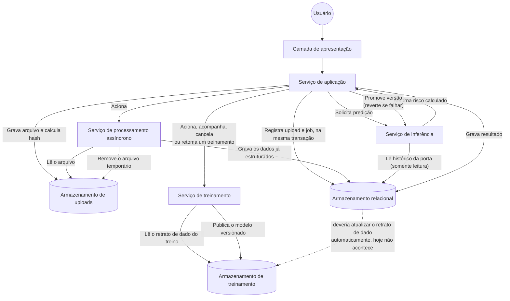
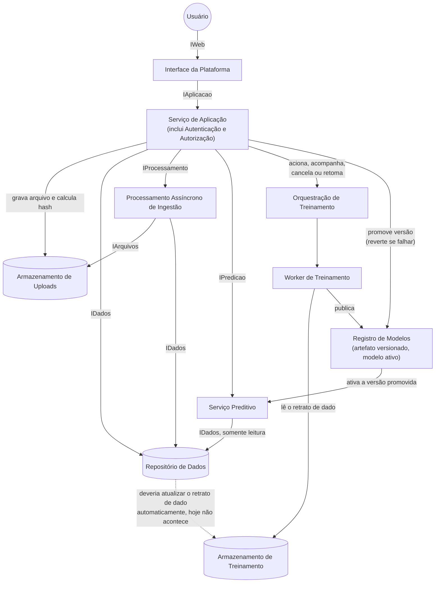

import { Image } from 'astro:assets';
import Background from '../../../../assets/sprints/sprint1/background_title.png';

  <Image src={Background} alt="Banner Motiva" format="png" style="position: absolute; inset: 0; width: 100%; height: 100%; object-fit: cover; z-index: 0;"/>
  <h2 style="position: relative; z-index: 1; color: white; margin: 0;">1. Por que uma arquitetura agnóstica</h2>

Antes de nomear qualquer tecnologia, vale descrever a solução pelo que ela faz e não pelo que ela usa. Essa ordem não é uma formalidade; Descrever o papel antes da ferramenta é o que permite comparar alternativas de tecnologia com critério depois, em vez de escolher só por familiaridade e justificar a escolha depois. Isso também é o que torna a arquitetura mais estável que a implementação por trás dela. Os papéis de um sistema continuam fazendo sentido mesmo que uma parte específica seja trocada por outra equivalente, e mesmo quando, como no caso do retreino descrito mais adiante neste documento, a implementação por trás de um papel ainda está incompleta.

Essa separação já existe no código do backend, só que em outro nível. O ADR de Clean Architecture do projeto separa a regra de negócio dos detalhes técnicos (banco, framework) por trás de interfaces, justamente para que trocar um detalhe de infraestrutura não obrigue a alterar a regra de negócio. A visão agnóstica aplica o mesmo princípio um nível acima, na arquitetura como um todo e não só dentro do código.

Um exemplo disso sera o serviço de processamento assíncrono da plataforma, que hoje roda em uma fila implementada em cima do próprio PostgreSQL. Se o volume de uploads crescer e essa fila for substituída por um broker dedicado, a frase "existe um serviço de processamento assíncrono que trata arquivos grandes sem travar o resto do sistema" continua verdadeira sem nenhuma alteração. A técnologia pode mudar mas não o papel que ela cumpre.

---

  <Image src={Background} alt="Banner Motiva" format="png" style="position: absolute; inset: 0; width: 100%; height: 100%; object-fit: cover; z-index: 0;"/>
  <h2 style="position: relative; z-index: 1; color: white; margin: 0;">2. Continuando da Sprint 3</h2>

A Arquitetura UML da Sprint 3 descreveu a plataforma tendo um Frontend, Backend, banco de dados e o serviço de modelo, junto com os casos de uso e o passo a passo de cada tela. Este documento mostra como o sistema evoluiu daquele ponto até aqui, mais especificamente para o caminho que o dado percorre, e apontando o que já funciona de ponta a ponta e o que ainda é só uma simulação na interface.

A plataforma tem cinco papéis principais. Uma camada de apresentação, que o usuário acessa; um serviço de aplicação, que concentra as regras de negócio (incluindo autenticação e autorização); um serviço de processamento assíncrono, que trata arquivos grandes sem travar o resto do sistema; um serviço de inferência, separado por resolver um problema diferente (aprendizado de máquina, não regra de negócio); e um serviço de treinamento, que orquestra a geração de novas versões do modelo. Três formas de armazenamento apoiam isso: um armazenamento relacional, para o dado estruturado; um armazenamento de uploads, para os arquivos brutos recebidos antes de serem interpretados e descartados depois; e um armazenamento de treinamento, para os retratos de dado usados no treino e os artefatos de modelo já versionados.

---

  <Image src={Background} alt="Banner Motiva" format="png" style="position: absolute; inset: 0; width: 100%; height: 100%; object-fit: cover; z-index: 0;"/>
  <h2 style="position: relative; z-index: 1; color: white; margin: 0;">3. Diagrama de Fluxo de Dados</h2>

O diagrama mostra os caminhos reais que o dado percorre na plataforma hoje. Só um trecho continua tracejado: a atualização automática do retrato de dado usado no treino a partir do armazenamento relacional, que ainda não existe.

---

  <Image src={Background} alt="Banner Motiva" format="png" style="position: absolute; inset: 0; width: 100%; height: 100%; object-fit: cover; z-index: 0;"/>
  <h2 style="position: relative; z-index: 1; color: white; margin: 0;">4. Explicando cada caminho</h2>

**Enviar um arquivo novo**: o usuário manda uma planilha pela tela. Diferente do que uma primeira leitura do fluxo sugere, quem grava o arquivo no armazenamento de uploads é o próprio serviço de aplicação, ele recebe o arquivo, calcula um hash (para detectar duplicidade) e só depois registra o upload e o job de processamento no armazenamento relacional, na mesma transação. O serviço de processamento assíncrono entra depois: ele lê o arquivo já salvo, grava as linhas estruturadas no armazenamento relacional, e remove o arquivo temporário ao final. Esse desenho evita perder o registro de um upload se o processamento falhar no meio do caminho.

**Pedir uma predição**: o serviço de aplicação passa a porta pro serviço de inferência. Esse serviço busca sozinho, no armazenamento relacional (por uma conexão somente leitura), o histórico que precisa daquela porta, calcula o risco, e devolve a resposta. Quem grava esse resultado de volta no banco é o serviço de aplicação, não o serviço de inferência.

**Pedir um treinamento**: o serviço de aplicação aciona um treinamento real no serviço de treinamento, que roda de forma assíncrona, grava progresso e pontos de retomada, e pode ser cancelado ou retomado se falhar no meio do caminho. Quando um modelo novo termina de treinar, promovê-lo dispara automaticamente uma rodada oficial de predição com a versão nova; se essa rodada falhar, a promoção é revertida sozinha para a versão anterior.

**O que ainda falta**: o serviço de treinamento não lê o armazenamento relacional para montar o retrato de dado do treino. Ele usa um retrato fixo (hoje, os arquivos `painel.parquet` e `ZM01_limpa.xlsx` guardados no armazenamento de treinamento). Ou seja, o treinamento é real, mas pode treinar com um retrato que não contém os dados mais recentes recebidos pela plataforma. Essa é a única parte que falta nesse fluxo.

---

  <Image src={Background} alt="Banner Motiva" format="png" style="position: absolute; inset: 0; width: 100%; height: 100%; object-fit: cover; z-index: 0;"/>
  <h2 style="position: relative; z-index: 1; color: white; margin: 0;">5. Objetivo do Diagrama de Componentes</h2>

O Diagrama de Componentes apresenta a estrutura lógica da plataforma, evidenciando **quais componentes formam a solução, quais responsabilidades cada um possui e quais interfaces permitem a comunicação entre eles**.

Essa visão complementa o Diagrama de Fluxo de Dados da seção anterior. Enquanto o fluxo descreve **por onde os dados passam e em qual sequência**, o Diagrama de Componentes descreve **como a solução está decomposta estruturalmente e quais dependências existem entre suas partes**.

A representação foi construída, do mesmo jeito, de forma agnóstica de tecnologia: os nomes utilizados no diagrama representam papéis arquiteturais, não produtos, linguagens, frameworks ou provedores específicos, permitindo que a tecnologia por trás de um componente seja substituída futuramente sem alterar sua responsabilidade, desde que o mesmo contrato de comunicação continue sendo atendido.

---

  <Image src={Background} alt="Banner Motiva" format="png" style="position: absolute; inset: 0; width: 100%; height: 100%; object-fit: cover; z-index: 0;"/>
  <h2 style="position: relative; z-index: 1; color: white; margin: 0;">6. Critério utilizado para decompor a solução</h2>

A definição dos componentes foi realizada a partir de três fontes principais:

1. **Requisitos funcionais e não funcionais**, utilizados como referência de escopo e como fonte de verdade para definir as responsabilidades que obrigatoriamente deveriam estar presentes na arquitetura.
2. **Frontend implementado**, utilizado para identificar os módulos efetivamente disponibilizados ao usuário, como Dashboard, Alertas, Manutenções, Portas e Inspeções.
3. **Backend e fluxo de processamento**, utilizados para identificar as responsabilidades internas da aplicação, incluindo autenticação, ingestão, processamento assíncrono, persistência, inspeções e execução das predições.

A partir desse cruzamento, foram definidos componentes com responsabilidades próprias e contratos explícitos de comunicação. A decomposição procurou evitar componentes amplos demais, que esconderiam responsabilidades distintas, e componentes excessivamente pequenos, que tornariam o diagrama difícil de interpretar.

Requisitos como segurança, integridade, privacidade, escalabilidade e manutenibilidade influenciam vários desses componentes simultaneamente e, por isso, são tratados como preocupações transversais da arquitetura.

---

  <Image src={Background} alt="Banner Motiva" format="png" style="position: absolute; inset: 0; width: 100%; height: 100%; object-fit: cover; z-index: 0;"/>
  <h2 style="position: relative; z-index: 1; color: white; margin: 0;">7. Diagrama de Componentes</h2>

Cada caixa representa uma unidade lógica com responsabilidade própria; as setas rotuladas representam os contratos (interfaces) pelos quais um componente utiliza serviços de outro. A única ligação tracejada é a mesma lacuna já descrita no Diagrama de Fluxo de Dados: o retrato de dado do treino não é atualizado automaticamente a partir do Repositório de Dados.

| Interface | Papel no diagrama |
| --- | --- |
| **IWeb** | Ponto de interação entre o usuário e a Interface da Plataforma. |
| **IAplicacao** | Contrato utilizado pela Interface da Plataforma para acessar as funcionalidades do Serviço de Aplicação. |
| **IProcessamento** | Solicitação de processamento assíncrono dos arquivos recebidos pela aplicação. |
| **IPredicao** | Contrato utilizado para solicitar inferências ao Serviço Preditivo e receber seus resultados. |
| **IDados** | Acesso ao Repositório de Dados, que é utilizado pelo Serviço de Aplicação (leitura e escrita), pelo Processamento Assíncrono (escrita dos dados estruturados) e pelo Serviço Preditivo (somente leitura). |
| **IArquivos** | Interação do Processamento Assíncrono com o Armazenamento de Uploads. |

A utilização de interfaces explícitas reforça o desacoplamento entre os componentes. Assim, um componente pode ser alterado ou substituído desde que continue atendendo ao contrato esperado pelos componentes que dependem dele.

---

  <Image src={Background} alt="Banner Motiva" format="png" style="position: absolute; inset: 0; width: 100%; height: 100%; object-fit: cover; z-index: 0;"/>
  <h2 style="position: relative; z-index: 1; color: white; margin: 0;">8. Interface da Plataforma</h2>

A **Interface da Plataforma** representa o componente utilizado pela equipe de Engenharia de Manutenção para acessar a solução (a mesma camada de apresentação da seção 2). Ela se comunica com o Serviço de Aplicação por meio da interface `IAplicacao` e agrupa os módulos disponibilizados ao usuário autenticado:

| Componente | Responsabilidade principal |
| --- | --- |
| **Dashboard** | Apresentar uma visão consolidada da operação, incluindo portas monitoradas, portas em risco, inspeções e estações críticas. |
| **Alertas** | Apresentar os alertas preditivos e permitir o envio do histórico de alarmes utilizado pela plataforma. |
| **Manutenções** | Consultar, filtrar, cadastrar e importar ordens de manutenção. |
| **Portas** | Permitir a navegação por linha, estação, plataforma e porta, além de disponibilizar a ação de realização da predição. |
| **Inspeções** | Criar, consultar e acompanhar inspeções e seus respectivos estados. |
| **Laboratório de Engenharia** | Acompanhar experimentos, métricas por versão de modelo e o ciclo de treinamento. |

A Interface da Plataforma não acessa diretamente o repositório de dados nem o modelo preditivo. Sua função é coletar ações do usuário, encaminhá-las ao Serviço de Aplicação e apresentar os resultados devolvidos. Essa separação reduz o acoplamento entre apresentação e regras de negócio.

---

  <Image src={Background} alt="Banner Motiva" format="png" style="position: absolute; inset: 0; width: 100%; height: 100%; object-fit: cover; z-index: 0;"/>
  <h2 style="position: relative; z-index: 1; color: white; margin: 0;">9. Serviço de Aplicação</h2>

O **Serviço de Aplicação** concentra as regras de negócio e coordena a comunicação entre a Interface da Plataforma, o processamento assíncrono, o Serviço Preditivo, o Registro de Modelos e a persistência.

Os principais componentes são:

| Componente | Responsabilidade principal | Requisitos relacionados |
| --- | --- | --- |
| **Módulo de Autenticação e Controle de Acesso** | Validar credenciais, controlar a sessão e restringir o acesso a recursos protegidos. | RF01, RF02, RNF01, RNF02, RNF03 |
| **Serviço de Ingestão de Dados** | Receber os dados de alarmes e manutenções enviados à plataforma, gravar o arquivo e iniciar seu processamento. | RF03, RF04, RNF05, RNF06 |
| **Gestão de Manutenções** | Coordenar cadastro, consulta e filtros dos registros de manutenção. | RF04, RF05, RF06 |
| **Gestão de Inspeções** | Criar, consultar, priorizar e atualizar o status das inspeções. | RF06, RF11 |
| **Gestão de Portas** | Coordenar a consulta das portas, estações, plataformas e seus respectivos estados. | RF07, RF09, RF11 |
| **Orquestração de Predição** | Preparar a solicitação de inferência e registrar os resultados gerados. | RF07, RF08, RF09 |
| **Orquestração de Treinamento e Promoção** | Acionar, acompanhar, cancelar e retomar um treinamento; promover uma versão e disparar a rodada oficial de predição, revertendo a promoção se ela falhar. | RF07 |
| **Serviço de Dashboard** | Consolidar os dados necessários aos indicadores apresentados na interface. | RF10, RF11 |

**Sobre autenticação**: diferente de uma versão anterior deste documento, o **Módulo de Autenticação e Controle de Acesso não é um componente implantável separado**. Essa parte fica dentro do Serviço de Aplicação, validando credenciais e aplicando controle de papel (role) sobre as mesmas rotas do backend. Essa correção evita sugerir uma dependência de rede que não existe hoje. Se a plataforma migrar para um provedor de identidade externo (como Keycloak, Auth0 ou Azure Entra ID), aí sim esse módulo passaria a ser um componente próprio, com uma interface real entre ele e o Serviço de Aplicação.

Essas responsabilidades dependem de outros componentes especializados por interfaces bem definidas: o processamento usa `IProcessamento`, a predição usa `IPredicao`, o acesso aos dados usa `IDados`. Isso evita que a Interface da Plataforma se comunique diretamente com persistência ou com o modelo de machine learning.

---

  <Image src={Background} alt="Banner Motiva" format="png" style="position: absolute; inset: 0; width: 100%; height: 100%; object-fit: cover; z-index: 0;"/>
  <h2 style="position: relative; z-index: 1; color: white; margin: 0;">10. Processamento Assíncrono de Ingestão</h2>

O componente **Processamento Assíncrono de Ingestão** (o mesmo serviço de processamento assíncrono da seção 2) foi separado do Serviço de Aplicação porque operações de ingestão podem envolver volumes maiores de dados e demandar mais tempo do que uma requisição comum da interface.

A ordem real de execução é importante porque é fácil descrever ela ao contrário: o Serviço de Aplicação grava o arquivo no Armazenamento de Uploads e calcula o hash antes de qualquer processamento, registrando o upload e o job na mesma transação do Repositório de Dados. Depois disso o Processamento Assíncrono entra em ação: ele lê o arquivo pela interface `IArquivos`, valida e normaliza os registros, grava os dados já estruturados no Repositório de Dados pela interface `IDados`, e remove o arquivo temporário ao final. Ou seja, o componente que persiste o arquivo bruto é o Serviço de Aplicação, não o Processamento Assíncrono, o processamento lê e depois limpa.

---

  <Image src={Background} alt="Banner Motiva" format="png" style="position: absolute; inset: 0; width: 100%; height: 100%; object-fit: cover; z-index: 0;"/>
  <h2 style="position: relative; z-index: 1; color: white; margin: 0;">11. Serviço Preditivo</h2>

O **Serviço Preditivo** (o serviço de inferência da seção 2) é o componente especializado na execução do modelo de machine learning, usando os dados históricos disponibilizados pela plataforma pra retornar a classificação da porta dentro do horizonte de previsão definido: **Estável** ou **Em risco de falha**.

A solicitação de inferência parte do Serviço de Aplicação por meio da interface `IPredicao`. Para montar as features de uma porta, o Serviço Preditivo também acessa diretamente o Repositório de Dados por uma conexão somente leitura, pela mesma interface `IDados`. Essa dependência existe de fato hoje e precisa aparecer no diagrama, mesmo sendo um acesso mais restrito (leitura apenas) que o do Serviço de Aplicação. Os resultados retornam ao Serviço de Aplicação, que os registra e os disponibiliza para Dashboard, Alertas, Portas e Inspeções.

---

  <Image src={Background} alt="Banner Motiva" format="png" style="position: absolute; inset: 0; width: 100%; height: 100%; object-fit: cover; z-index: 0;"/>
  <h2 style="position: relative; z-index: 1; color: white; margin: 0;">12. Orquestração de Treinamento, Worker e Registro de Modelos</h2>

Esses três componentes formam o ciclo de MLOps da plataforma:

**Orquestração de Treinamento**: recebe do Serviço de Aplicação o pedido de iniciar, cancelar ou retomar um treinamento, e coordena o ciclo de vida desse job.

**Worker de Treinamento**: executa o treinamento de fato, como um processo separado do que atende requisições de predição. Grava progresso e pontos de checkpoint durante a execução, o que permite retomar um treinamento que falhou a partir do ponto onde parou, em vez de recomeçar do zero. Ao terminar, publica o artefato do modelo e seu manifesto no Armazenamento de Treinamento.

**Registro de Modelos**: mantém o histórico de versões de modelo, qual delas está ativa, e a operação de promoção, trocar a versão ativa. Promover uma versão nova dispara automaticamente uma rodada oficial de predição usando esse modelo; se essa rodada falhar, o Registro reverte sozinho para a versão anterior, sem intervenção manual.

**O que ainda não existe**: nenhum desses três componentes lê o Repositório de Dados para montar o retrato de dado do treinamento. O Worker de Treinamento sempre parte de um retrato já salvo no Armazenamento de Treinamento, hoje arquivos nomeados fixos, não uma consulta ao dado mais recente. Fechar essa lacuna exigiria um passo adicional (não implementado) que regenerasse esse retrato a partir do Repositório de Dados antes de cada treinamento.

---

  <Image src={Background} alt="Banner Motiva" format="png" style="position: absolute; inset: 0; width: 100%; height: 100%; object-fit: cover; z-index: 0;"/>
  <h2 style="position: relative; z-index: 1; color: white; margin: 0;">13. Persistência e Armazenamento</h2>

A persistência foi dividida em três componentes com responsabilidades e ciclos de vida diferentes. Isso porque dois deles são formas de armazenamento de objetos, mas conceitualmente distintas o suficiente para não caber na mesma caixa:

| Componente | Responsabilidade | Ciclo de vida |
| --- | --- | --- |
| **Repositório de Dados** | Armazenar usuários, estações, portas, alarmes, manutenções, predições, inspeções e o histórico de treinamentos e versões de modelo. | Permanente. |
| **Armazenamento de Uploads** | Manter o arquivo bruto de um upload só até ele ser processado. | Temporário, o arquivo é removido depois que o Processamento Assíncrono termina. |
| **Armazenamento de Treinamento** | Manter o retrato de dado usado no treino e os artefatos de modelo já versionados. | Permanente, mas de escrita pouco frequente (só a cada treinamento). |

Nenhum desses três se comunica diretamente com outro. Quem lê e grava no Armazenamento de Uploads e no Repositório de Dados é sempre o Serviço de Aplicação ou o Processamento Assíncrono. Não existe uma interface direta entre os dois armazenamentos, mesmo eles guardando informação relacionada ao mesmo upload.

---

  <Image src={Background} alt="Banner Motiva" format="png" style="position: absolute; inset: 0; width: 100%; height: 100%; object-fit: cover; z-index: 0;"/>
  <h2 style="position: relative; z-index: 1; color: white; margin: 0;">14. Requisitos não funcionais na arquitetura</h2>

Os requisitos não funcionais não foram representados como serviços isolados, pois atuam de forma transversal sobre diferentes partes da solução. A tabela abaixo substitui uma versão anterior que só citava, em termos gerais, "serviço, persistência e interfaces" como evidência — cada linha agora aponta uma decisão concreta e seu estado real, não só a intenção.

| Requisito | Decisão arquitetural | Evidência no código/infraestrutura | Estado |
| --- | --- | --- | --- |
| RNF01 (autenticação) | Controle de sessão por token assinado (JWT) e validação em middleware. | Módulo de Autenticação e Controle de Acesso, dentro do Serviço de Aplicação. | Implementado |
| RNF02 (proteção de dados) | Controle de acesso por papel (role) nas rotas protegidas, e acesso anônimo desabilitado nos três armazenamentos de objetos. | Middleware de autorização do Serviço de Aplicação; política de acesso e configuração de anonimato aplicadas aos três buckets (uploads, dado de treino e artefatos). | Implementado |
| RNF03 (privacidade) | Segredos e credenciais fora do repositório. | Variáveis de ambiente/arquivo de configuração local, não versionado. | Implementado |
| RNF04 (comunicação segura) | Canal privado dedicado entre a VPS da aplicação e a VPS de Machine Learning. | Túnel de rede privado entre as duas VPSs; conexão do Serviço Preditivo ao Repositório de Dados usa credencial somente leitura. | Implementado |
| RNF05 (integridade dos dados) | Registro do upload e do job de processamento na mesma transação, com verificação de hash para evitar duplicidade. | Fluxo de ingestão do Serviço de Aplicação. | Implementado |
| RNF06 (validação de entrada) | Validação de formato e campos antes de gravar no Repositório de Dados. | Etapa de validação do Processamento Assíncrono. | Implementado |
| RNF07 (usabilidade) | Interface orientada a papéis (operação e engenharia), sem exigir conhecimento técnico. | Módulos da Interface da Plataforma (seção 8). | Implementado |
| RNF08 (escalabilidade) | Processamento assíncrono e treinamento como processos separados do atendimento de requisições. | Processamento Assíncrono de Ingestão e Worker de Treinamento (seções 10 e 12). | Implementado |
| RNF09 (manutenibilidade) | Componentes com responsabilidade única e comunicação só por interface. | Separação entre Serviço de Aplicação, Processamento, Serviço Preditivo, Orquestração de Treinamento e persistência. | Implementado |

Alguns detalhes de evidência (backup, limites de recurso, rotação de segredo) ainda não têm uma verificação formal registrada e ficam como próximo passo de auditoria, não como requisito não atendido.

---

  <Image src={Background} alt="Banner Motiva" format="png" style="position: absolute; inset: 0; width: 100%; height: 100%; object-fit: cover; z-index: 0;"/>
  <h2 style="position: relative; z-index: 1; color: white; margin: 0;">15. Rastreabilidade com os requisitos</h2>

A arquitetura foi verificada contra todos os requisitos definidos para a solução.

| Grupo | Componentes principais | Estado |
| --- | --- | --- |
| **RF01–RF02** | Interface da Plataforma; Serviço de Aplicação (Módulo de Autenticação) | Atendido |
| **RF03–RF04** | Serviço de Ingestão; Processamento Assíncrono; Repositório de Dados; Armazenamento de Uploads | Atendido |
| **RF05–RF06** | Gestão de Manutenções; Gestão de Inspeções; Alertas; Repositório de Dados | Atendido |
| **RF07** | Gestão de Portas; Orquestração de Predição; Orquestração de Treinamento; Serviço Preditivo | Atendido |
| **RF08** | Orquestração de Predição | Parcialmente atendido: o horizonte de previsão é sempre fixado em sete dias pelo Serviço de Aplicação, independente do valor informado. A opção de configurar esse horizonte ainda não está implementada. |
| **RF09** | Gestão de Portas; Serviço Preditivo | Atendido |
| **RF10** | Serviço de Dashboard; Dashboard | Atendido |
| **RF11** | Serviço Preditivo; Gestão de Portas; Gestão de Inspeções; Dashboard | Atendido |

A verificação mostrou que todos os requisitos possuem pelo menos um componente responsável na arquitetura, com uma observação no RF08.

---

  <Image src={Background} alt="Banner Motiva" format="png" style="position: absolute; inset: 0; width: 100%; height: 100%; object-fit: cover; z-index: 0;"/>
  <h2 style="position: relative; z-index: 1; color: white; margin: 0;">16. Conclusão</h2>

A arquitetura foi construída a partir dos requisitos do sistema e confrontada com o frontend, o backend e o serviço de modelo efetivamente implementados. A visão agnóstica evidencia que a plataforma é formada por componentes independentes — Interface da Plataforma, Serviço de Aplicação, Processamento Assíncrono, Serviço Preditivo, Orquestração de Treinamento, Worker de Treinamento, Registro de Modelos, Repositório de Dados, Armazenamento de Uploads e Armazenamento de Treinamento — com contratos e dependências explícitos entre si, e por um fluxo de dados que mostra como a informação percorre esses componentes na prática, incluindo a única parte que ainda não está implementada. Essa organização reduz o acoplamento entre implementações e favorece segurança, integridade, escalabilidade e manutenibilidade, mantendo a rastreabilidade com os requisitos funcionais e não funcionais definidos para o projeto.
