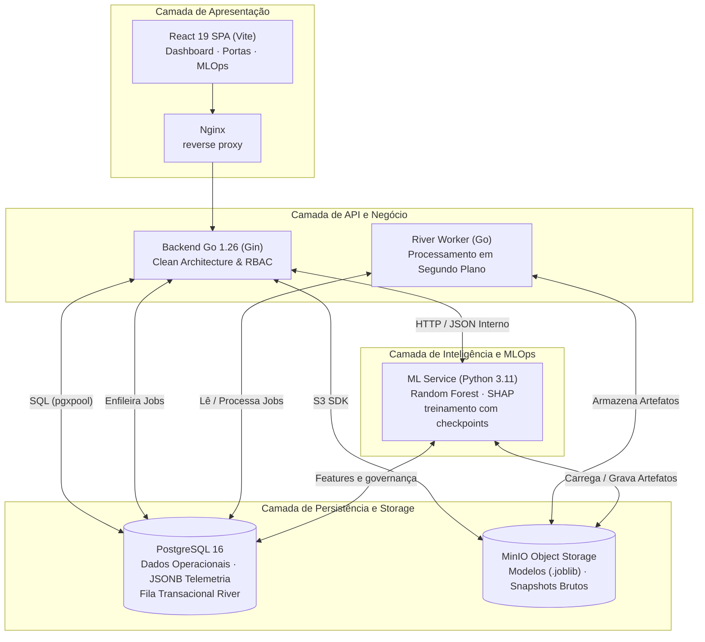

import ImageCarousel from '../../../../components/ImageCarousel.astro';
import telaLogin from '../../../../assets/sprints/sprint3/frontend/Login.png';
import telaDashboard from '../../../../assets/sprints/sprint3/frontend/dashboard.png';
import telaManutencoes from '../../../../assets/sprints/sprint3/frontend/Manutencoes.png';
import telaAlertas from '../../../../assets/sprints/sprint3/frontend/Alertas.png';
import telaPortas from '../../../../assets/sprints/sprint3/frontend/Portas.png';
import telaPortasEstacao from '../../../../assets/sprints/sprint3/frontend/PortasEstacao.png';
import telaInspecoes from '../../../../assets/sprints/sprint3/frontend/Inspecoes.png';
import telaAbrirInspecao from '../../../../assets/sprints/sprint3/frontend/AbrirOrdemInspec.png';

## 1. Introdução e critérios objetivos de seleção

A plataforma foi construída para apoiar a manutenção preditiva das Portas de Plataforma (*Platform Screen Doors* ou PSDs) da Linha 4-Amarela. A escolha das tecnologias precisava caber no orçamento da POC, ser executável pela equipe e manter uma rota clara para uma implantação mais robusta. Por isso, a análise abaixo separa as metas definidas para o sistema dos resultados que foram medidos nos testes.

Para assegurar que as decisões técnicas fossem sustentáveis e livres de escolhas arbitrárias, o grupo estabeleceu **cinco critérios objetivos de avaliação** que nortearam a seleção de cada tecnologia:

1. **Custo (TCO, *Total Cost of Ownership*):** preferência por ferramentas sem licença proprietária e com consumo compatível com as VPSs disponíveis. O custo considerado inclui operação, armazenamento, observabilidade e esforço de manutenção.
2. **Curva de Aprendizado e Produtividade:** Aderência ao conjunto de habilidades da equipe de engenharia e ciência de dados, permitindo entregas contínuas ao longo das cinco sprints sem comprometer o rigor metodológico.
3. **Maturidade do Ecossistema:** Escolha de ferramentas consolidadas no mercado corporativo e industrial, com documentação farta, comunidades ativas, suporte a longo prazo (LTS) e bibliotecas de integração estáveis.
4. **Aderência aos Requisitos Não Funcionais (RNFs):** integridade transacional, isolamento de privilégios, recuperação após reinício, observabilidade e possibilidade de separar a inferência do treinamento. As metas de latência e disponibilidade são registradas como metas de evolução quando ainda não há medição representativa.
5. **Métricas de Desempenho:** tempo de build, tempo de teste, consumo de memória, latência observada, tempo de inferência e duração do treinamento. Cada número citado na documentação deve indicar a origem da medição.

### Como as evidências foram classificadas

| Classificação | Uso na análise |
| :--- | :--- |
| **Medido** | Resultado obtido em um teste reproduzível, com contexto e ferramenta informados. |
| **Configurado** | Valor presente no código ou na infraestrutura, sem representar uma garantia de produção. |
| **Meta** | Critério desejado para uma próxima etapa de validação. |
| **Trade-off** | Custo ou limitação aceito para obter uma vantagem concreta. |

---

## 2. Visão geral da arquitetura tecnológica por camadas

A arquitetura da solução foi projetada de forma modular e desacoplada, distribuindo responsabilidades em camadas bem delimitadas para evitar gargalos de processamento e garantir manutenibilidade independente.

A tabela a seguir sumariza as tecnologias selecionadas para cada camada do ecossistema:

| Camada Arquitetural | Tecnologia Adotada | Papel no Sistema | Alternativas Descartadas |
| :--- | :--- | :--- | :--- |
| **Apresentação (Frontend)** | React 19.2 + Vite 8 + CSS próprio | SPA para dashboard, estações, portas, predições, inspeções e laboratório de MLOps. | Next.js, Vue.js, Angular, Tailwind CSS |
| **API e orquestração (backend)** | Go 1.26 + Gin 1.12 | API REST, casos de uso, RBAC, ingestão, scheduler e integração com PostgreSQL, MinIO e ML Service. | Node.js, Python/FastAPI, Java/Spring Boot |
| **Inteligência e MLOps** | Python 3.11 + Flask + scikit-learn 1.4.2 + SHAP + joblib | Engenharia de atributos, inferência, avaliação temporal, treinamento assíncrono e registro de artefatos. | XGBoost, LSTM/GRU, PyTorch, LightGBM |
| **Persistência relacional e fila** | PostgreSQL 16 + River Queue 0.47 | Dados operacionais, usuários, predições, governança de modelos e jobs duráveis de ingestão. | MongoDB, MySQL, Redis + RabbitMQ, Kafka |
| **Armazenamento de objetos** | MinIO compatível com S3 | Planilhas de ingestão, datasets de treinamento, arquivos `.joblib` e manifests privados. | Supabase Storage, AWS S3, disco local, Ceph |
| **Infraestrutura e deploy** | Docker + Docker Compose + golang-migrate | Imagens reprodutíveis, volumes persistentes, rede interna e migrations versionadas. | Kubernetes, instalação bare-metal, Ansible |
| **Observabilidade** | OpenTelemetry + Prometheus + Grafana + Loki + Tempo | Métricas, logs estruturados e traces correlacionados entre API, worker e ML Service. | Elastic Stack, Datadog, CloudWatch, Application Insights |
| **Rede entre VPSs** | WireGuard | Canal privado entre a VPS da aplicação e a VPS de Machine Learning. | Exposição pública com HTTPS, VPN gerenciada, rede privada de um único provedor |



Em desenvolvimento, os serviços compartilham a rede Docker `backend-network`. Na implantação distribuída, a VPS 1 executa frontend, API, worker e observabilidade; a VPS 2 executa o ML Service, o worker de treinamento e o MinIO de modelos. O WireGuard liga as duas redes por `10.50.0.1` e `10.50.0.2`.

> [!TIP]
> **Imagem sugerida 1: visão geral da arquitetura**
> Use uma imagem horizontal para abrir a seção. O diagrama deve mostrar as duas VPSs, o PostgreSQL gerenciado, os dois MinIO e o túnel WireGuard. As setas precisam indicar o caminho de uma requisição de predição e de um upload de planilha.
>
> **Prompt para geração:**
> ```text
> Crie um diagrama horizontal limpo de arquitetura de software para um sistema de manutenção preditiva de portas de plataforma ferroviária. Use fundo branco, paleta com azul elétrico inspirado na Motiva e azul-marinho escuro, estilo técnico editorial plano, conectores azuis finos e contêineres cinza discretos, sem gradientes nem efeitos de vidro 3D. Mostre duas zonas grandes de infraestrutura: “VPS 1 Azure”, com Nginx, frontend React, API Go, worker de ingestão Go, conexão com PostgreSQL, Prometheus, Grafana, Loki e Tempo; e “VPS 2 AWS”, com serviço de ML em Python, worker de treinamento e buckets privados do MinIO para `training-data` e `artefacts`. Posicione o PostgreSQL do Supabase fora das zonas das VPSs e conecte-o aos serviços Go e Python. Desenhe um túnel azul seguro do WireGuard entre as duas zonas. Inclua os logotipos oficiais reconhecíveis de React, Go, Python, PostgreSQL, MinIO, Docker, Grafana, Prometheus, Loki, Tempo, AWS, Azure e WireGuard. Use rótulos curtos, espaçamento generoso, setas com direção clara e alto contraste, em estilo de documentação acadêmica de arquitetura, proporção 16:9 e alta resolução. Evite ilustrações decorativas, neon, fundo escuro e métricas inventadas. Deixe espaço suficiente para corrigir os rótulos na pós-produção.
> ```

---

### 3.6 Observabilidade: OpenTelemetry, Prometheus, Grafana, Loki e Tempo

A observabilidade foi separada em três sinais. Prometheus coleta métricas, Loki recebe logs estruturados e Tempo armazena traces. O OpenTelemetry Collector recebe os spans da API e do worker e encaminha os dados para o backend de traces. Grafana reúne as fontes em dashboards e permite relacionar um trace aos logs com o mesmo `trace_id`.

#### Justificativa por critérios objetivos

- **Custo:** A stack é composta por projetos abertos e pode rodar nos containers da VPS. Isso reduz custo de licença, mas transfere para a equipe a responsabilidade de retenção e capacidade de disco.
- **Maturidade:** Os componentes têm integração conhecida com Go, Docker e Grafana. O uso de protocolos OTLP e métricas Prometheus reduz dependência de uma API proprietária.
- **Aderência aos RNFs:** A propagação de contexto entre HTTP e jobs River permite investigar uma ingestão desde a requisição até o processamento assíncrono. Métricas de rota, runtime e host apoiam a análise de capacidade.

#### Impacto arquitetural e risco

- **Manutenibilidade:** Cada sinal tem uma responsabilidade clara e os dashboards são provisionados por arquivos versionados.
- **Confiabilidade:** Logs e traces ajudam a diagnosticar falhas, mas não substituem alertas, backup ou um plano de resposta.
- **Segurança:** Os endpoints de observabilidade ficam na rede interna e os logs devem evitar tokens, senhas e dados pessoais.
- **Risco:** retenção excessiva pode consumir o disco da VPS. **Mitigação:** definir retenção, rotação, limites de volume e alertas de capacidade.

> **Imagem sugerida 7: fluxo de observabilidade**
>
> ```text
> Crie um diagrama preciso de arquitetura de observabilidade sobre fundo branco. Mostre a API Go e o worker Go à esquerda enviando métricas ao Prometheus, logs estruturados ao Promtail e ao Loki, e traces pelo OpenTelemetry Collector até o Tempo. Posicione o Grafana à direita, conectado ao Prometheus, Loki e Tempo, com uma linha visível de correlação `trace_id` do Tempo para o Loki. Use os logotipos oficiais de OpenTelemetry, Prometheus, Grafana, Loki e Tempo, conectores em azul elétrico, rótulos azul-marinho e contêineres cinza-claro, em estilo técnico plano de documentação. Sem fundo escuro, neon ou dashboards fictícios; use proporção 16:9 e alta resolução. Deixe os rótulos editáveis na pós-produção.
> ```

### 3.7 Nuvem e rede: Azure, AWS EC2 e WireGuard

A distribuição em duas VPSs separa o tráfego operacional do processamento de Machine Learning. A VPS 1 concentra frontend, API, worker de ingestão e observabilidade. A VPS 2 concentra inferência, treinamento e o MinIO dos artefatos. O PostgreSQL permanece no Supabase e é acessado por conexão configurada no ambiente.

#### Justificativa por critérios objetivos

- **Custo:** A configuração foi escolhida dentro dos créditos disponíveis e permite dimensionar o serviço de ML separadamente quando o treinamento consumir mais CPU ou memória.
- **Aprendizado e operação:** VPSs Linux com Docker e Compose são conhecidas pela equipe e permitem controlar manualmente o processo de atualização.
- **Segurança:** WireGuard cria um túnel privado entre `10.50.0.1` e `10.50.0.2`. A porta da API de ML não precisa ser publicada para a internet; o firewall limita o acesso à rede do túnel.

#### Impacto arquitetural e risco

- **Manutenibilidade:** O mesmo repositório e Compose são usados nos dois hosts; o `.env` define somente endereços e credenciais específicos do ambiente.
- **Escalabilidade:** É possível trocar o tamanho de uma VPS ou mover o serviço para outro provedor sem mudar o contrato HTTP. A topologia atual não fornece failover automático.
- **Confiabilidade:** O túnel tem keepalive e healthcheck, mas uma falha de qualquer VPS interrompe parte do fluxo.
- **Risco:** latência, perda do túnel ou erro de atualização manual. **Mitigação:** monitorar o handshake, manter procedimento de rollback e testar o healthcheck antes de liberar uma versão.

## 3. Detalhamento e justificativa por camada tecnológica

### 3.1 Camada de Apresentação: React 19.2 + Vite 8 + CSS próprio

A interface atende o operador que acompanha estações, portas, alarmes, manutenções e inspeções, e o engenheiro que acompanha experimentos, modelos e treinamentos. A separação por perfil aparece na navegação e também é reforçada pela autorização do backend.

#### Justificativa por Critérios Objetivos:
- **Custo:** React, Vite e CSS próprio não acrescentam custo de licença. A operação usa os arquivos estáticos gerados no build e um Nginx para servi-los.
- **Curva de aprendizado:** A composição por componentes facilita a criação de telas que repetem o mesmo padrão de cards, tabelas, filtros e estados de carregamento. Vite reduz o tempo de feedback durante o desenvolvimento.
- **Maturidade:** React possui um ecossistema amplo para roteamento, gráficos e testes. Vite mantém o processo de build separado do código de negócio e permite trocar o servidor de arquivos sem alterar a aplicação.
- **Aderência aos RNFs:** O CSS próprio mantém o design sob controle e evita adicionar uma biblioteca de componentes inteira ao bundle. O build do frontend foi validado no CI; o tamanho e a experiência de carregamento continuam sujeitos a medição por ambiente.

#### Impacto Arquitetural:
- **Manutenibilidade:** Componentes como `TrainingPipeline`, `AppLayout`, `Toast` e `TableStandard` concentram comportamentos repetidos. O design fica em folhas CSS próximas às páginas e aos componentes.
- **Escalabilidade:** O resultado do build é estático, portanto o frontend não precisa de um processo Node em produção. A capacidade final depende do Nginx, da rede e do cache configurado.
- **Confiabilidade:** Skeletons, toasts e caches de dados tornam falhas de rede visíveis e evitam repetir chamadas ao retornar a uma seção.
- **Segurança:** O React escapa texto renderizado por padrão. A proteção de rotas e a validade do JWT continuam sendo responsabilidades do backend; o frontend não é tratado como fronteira de confiança.

#### Riscos Identificados e Mitigação:
- **Risco:** Re-renderizações em cascata quando o status do treinamento é atualizado.
- **Mitigação:** Manter o estado do pipeline isolado, comparar o identificador do job antes de aplicar uma atualização e medir o comportamento com dados reais antes de aumentar a frequência de polling.

<ImageCarousel
  label="Telas do frontend em uso"
  images={[
    { src: telaLogin, alt: 'Tela de login da plataforma Motiva', caption: 'Login e autenticação' },
    { src: telaDashboard, alt: 'Dashboard operacional da plataforma Motiva', caption: 'Dashboard operacional' },
    { src: telaManutencoes, alt: 'Tela de listagem de manutenções', caption: 'Manutenções' },
    { src: telaAlertas, alt: 'Tela de listagem de alertas', caption: 'Alertas' },
    { src: telaPortas, alt: 'Tela de listagem de portas', caption: 'Portas monitoradas' },
    { src: telaPortasEstacao, alt: 'Mapa de portas por estação', caption: 'Portas por estação' },
    { src: telaInspecoes, alt: 'Tela de inspeções preventivas', caption: 'Inspeções' },
    { src: telaAbrirInspecao, alt: 'Formulário para abrir uma ordem de inspeção', caption: 'Abertura de inspeção' }
  ]}
/>

---

### 3.2 Camada de API e Orquestração: Go 1.26 + Gin 1.12

O backend funciona como o núcleo operacional da plataforma, integrando a interface React, o banco de dados PostgreSQL, o MinIO e o serviço de Machine Learning em Python.

#### Justificativa por Critérios Objetivos:
- **Custo e consumo:** O backend é compilado como binário estático com `CGO_ENABLED=0` e executado em uma imagem `scratch`. Isso reduz dependências no runtime, embora o consumo real dependa da carga e do pool de conexões.
- **Curva de aprendizado:** Interfaces pequenas e composição combinam com as camadas `domain`, `usecase`, `port` e `adapter`. O custo é que a equipe precisa conhecer um segundo ecossistema além do Python usado em ML.
- **Maturidade:** Gin, `pgx`, JWT, OpenTelemetry e Prometheus possuem integração direta no projeto. A maior parte da infraestrutura de apoio também é escrita em Go, o que facilita encontrar bibliotecas e exemplos.
- **Aderência aos RNFs:** Goroutines e I/O explícito permitem atender requisições e executar workers sem criar uma thread do sistema por operação. A latência e a capacidade devem ser confirmadas por carga; não são inferidas apenas pela escolha da linguagem.

#### Impacto Arquitetural:
- **Manutenibilidade:** Casos de uso como `mlops_usecase.go` recebem interfaces da camada `port` e não instanciam diretamente PostgreSQL, S3 ou Gin. Isso permite testar regras com fakes e trocar adaptadores sem reescrever o domínio.
- **Escalabilidade:** Aplicação estritamente *stateless*. As sessões de usuário são validadas por assinatura criptográfica HMAC-SHA256 em tokens JWT, permitindo escalabilidade horizontal imediata através da inicialização de múltiplas réplicas do contêiner atrás de um balanceador de carga.
- **Confiabilidade:** Tratamento explícito de erros (sem exceções não controladas que derrubam o processo silenciosamente). O middleware de *Recovery* do Gin intercepta eventuais falhas críticas e retorna respostas estruturadas de acordo com a RFC 7807 (*Problem Details*), impedindo a indisponibilidade do serviço.
- **Segurança:** O middleware valida JWT assinado com HMAC e as rotas de engenharia usam o papel legado `enginner` definido nas migrations. Consultas recebem parâmetros pelo driver `pgx`, mas a revisão de autorização, segredo e limites de entrada continua necessária em cada endpoint.

#### Riscos Identificados e Mitigação:
- **Risco:** Uma chamada síncrona ao ML Service pode aumentar a latência da API ou falhar quando o serviço remoto estiver indisponível.
- **Mitigação:** Circuit breaker no cliente, timeout explícito, healthchecks e fluxo assíncrono para treinamento. O backend registra o job e o frontend acompanha o progresso por consulta ao status persistido.

> **Imagem sugerida 3: Clean Architecture do backend**
>
> ```text
> Crie um diagrama preciso de Clean Architecture sobre fundo branco puro para um backend Go. Use quatro contornos azuis concêntricos ou em camadas, rotulados “Domínio”, “Casos de uso”, “Portas” e “Adaptadores”, com setas de dependência apontando para dentro. Ao redor dos adaptadores, mostre os logotipos de Gin HTTP, PostgreSQL/pgx, MinIO S3, River Queue, OpenTelemetry e Prometheus. Use tipografia azul-marinho, bordas em azul elétrico, preenchimentos cinza-claro e um estilo corporativo Motiva discreto. Sem fundo escuro, gradientes, código inventado ou objetos 3D decorativos. Diagrama técnico horizontal em 16:9, alta resolução, com rótulos editáveis na pós-produção.
> ```

---

### 3.3 Camada de Inteligência e MLOps: Python 3.11 + scikit-learn + SHAP + joblib

A camada analítica é responsável pela ingestão de logs de telemetria, tratamento de séries temporais de alarmes, separação temporal de dados, treinamento do modelo classificador e geração de explicações locais para os técnicos.

#### Justificativa por Critérios Objetivos:
- **Custo e execução:** O artefato atual usa `RandomForestClassifier` com 400 estimadores e roda em CPU. Isso atende ao tamanho atual do conjunto sem exigir GPU; o custo de uma execução maior precisa ser medido antes de extrapolar a escolha para produção.
- **Curva de aprendizado:** Python reúne pandas, NumPy, scikit-learn, SHAP e joblib no mesmo ecossistema dos notebooks exploratórios. O código de produção reaproveita as transformações documentadas no treinamento.
- **Aderência aos dados:** Random Forest foi escolhido para trabalhar com dados tabulares, variáveis categóricas transformadas e relações não lineares. A comparação com RNN/LSTM permanece registrada como experimento; a escolha não significa que redes neurais sejam inadequadas para todos os horizontes.
- **Explicabilidade:** SHAP produz contribuições por feature que podem ser exibidas ao engenheiro. Essas contribuições ajudam a investigar a classificação, mas não substituem validação operacional nem provam causalidade.

#### Impacto Arquitetural:
- **Manutenibilidade:** `src/modelo` possui domínio, casos de uso, portas e adaptadores. O contrato HTTP fica em `openapi.yaml`, enquanto o registry e o repositório de features são detalhes substituíveis.
- **Escalabilidade:** Inferência e treinamento são containers diferentes. O serviço de inferência pode receber recursos próprios, enquanto o worker de treinamento tem limites de CPU e memória configuráveis.
- **Confiabilidade:** O treinamento grava progresso e checkpoints. Uma retomada reaproveita saídas concluídas e registra a tentativa seguinte, evitando deixar um job indefinidamente em `running`.
- **Segurança:** Na arquitetura com duas VPSs, a porta de ML é acessada pelo WireGuard. O PostgreSQL do ML deve usar uma role de leitura e os artefatos ficam em buckets privados.

#### Riscos Identificados e Mitigação:
- **Risco:** Mudanças na operação podem alterar a distribuição das features e reduzir a qualidade da previsão.
- **Mitigação:** O serviço expõe a consulta de drift e o laboratório registra as métricas por versão. O limiar para retreinar deve ser definido com dados históricos e revisão do engenheiro, em vez de ser acionado apenas por uma métrica isolada.

> **Imagem sugerida 4: ciclo de vida do modelo**
>
> ```text
> Crie um diagrama limpo do ciclo de vida de MLOps sobre fundo branco para manutenção preditiva de portas de plataforma metroferroviária. Use um fluxo circular com seis etapas contornadas em azul: snapshot dos dados, engenharia de atributos, validação temporal, treinamento do Random Forest, registro do modelo no MinIO privado e predição oficial. Adicione um ramo separado de checkpoint e retomada que saia do treinamento e volte para a etapa que falhou. Mostre o PostgreSQL para status dos jobs e governança do modelo, o MinIO S3 para datasets e artefatos `.joblib`, e um logotipo do Python próximo ao serviço de treinamento. Use apenas azul elétrico, azul-marinho e cinza-claro, setas claras e espaçamento generoso; sem fundo escuro, neon ou métricas falsas. Estilo de relatório técnico em 16:9, com rótulos curtos e editáveis na pós-produção.
> ```

---

### 3.4 Camada de Persistência e Filas: PostgreSQL 16 + River Queue + MinIO

A persistência de uma plataforma preditiva ferroviária precisa conciliar dados relacionais estruturados (contas de acesso, estações, portas, ordens de serviço) com dados semiestruturados (telemetria de checkpoints, logs brutos e artefatos binários de modelos treinados).

#### Justificativa por Critérios Objetivos:
- **Custo e complexidade:** PostgreSQL e MinIO cobrem os dados relacionais, a fila de ingestão e os objetos do projeto sem introduzir um broker ou um serviço de storage adicional na POC. Essa escolha reduz componentes para operar, ao custo de concentrar mais responsabilidades nesses serviços.
- **Transações:** PostgreSQL fornece transações ACID, constraints e migrations. O progresso de treinamento pode conter dados estruturados e JSON, mas a modelagem deve ser avaliada antes de adicionar índices JSONB sem necessidade.
- **Fila River:** River persiste jobs no PostgreSQL e usa o próprio banco para reivindicar trabalhos. No projeto, ele atende principalmente a ingestão de alarmes e manutenções, com deduplicação por argumentos, retentativas e limpeza de objetos associada ao job.
- **MinIO:** A API compatível com S3 permite manter a mesma abstração entre desenvolvimento local e um storage gerenciado futuro. A compatibilidade de API não elimina a necessidade de backup, monitoramento e políticas de acesso.

#### Impacto Arquitetural:
- **Manutenibilidade:** Esquema de banco de dados centralizado e versionado por migrações incrementais em arquivos SQL puros (`000001` até `000017`), gerenciadas pela biblioteca `golang-migrate`. Qualquer evolução estrutural é rastreada no controle de versão e executada de forma idempotente tanto localmente quanto em produção.
- **Escalabilidade:** `pgxpool` reutiliza conexões e os workers River podem aumentar em número enquanto o banco suportar a carga. O limite precisa ser validado com volume de jobs e conexões reais.
- **Confiabilidade:** O PostgreSQL oferece WAL e o MinIO usa volumes persistentes. O fluxo de upload calcula SHA-256 e valida o artefato, mas a disponibilidade dos dados ainda depende de backup do volume e do banco.
- **Segurança:** Buckets são privados, o backend não recebe credenciais root do MinIO e os serviços usam a rede Docker. Credenciais devem ficar em secrets ou variáveis protegidas, nunca no repositório.

#### Riscos Identificados e Mitigação:
- **Risco:** Crescimento das tabelas River ou saturação do storage com uploads e artefatos antigos.
- **Mitigação:** Limpeza de jobs concluídos, expurgo de objetos processados, métricas de volume e uma política de retenção definida antes de operar em escala maior.

> **Imagem sugerida 5: PostgreSQL, River e MinIO**
>
> ```text
> Crie um diagrama limpo de arquitetura de dados sobre fundo branco para uma plataforma de manutenção preditiva. Mostre um cilindro PostgreSQL no centro, uma tabela de jobs River Queue dentro do limite do PostgreSQL e dois buckets privados MinIO S3 à direita: `ingestion-uploads` e `artefacts/training-data`. À esquerda, mostre a API Go e o worker de ingestão. Desenhe uma transação atômica desde o registro do upload até a inserção do job no River; depois, mostre o fluxo do worker para o MinIO e de volta ao PostgreSQL. Use linhas azuis para o fluxo de dados, laranja apenas para o armazenamento de objetos, rótulos azul-marinho e os logotipos oficiais de PostgreSQL, River, MinIO e Docker, em estilo técnico plano. Sem fundo escuro, gradientes ou números inventados; proporção 16:9 e alta resolução. Deixe os rótulos editáveis na pós-produção.
> ```

---

### 3.5 Camada de Infraestrutura e DevOps: Docker + Docker Compose + Golang-Migrate

Como a POC é executada em duas VPSs e também precisa funcionar localmente, a implantação foi organizada em Compose. Cada host constrói e inicia seus próprios serviços a partir do mesmo repositório, com diferenças controladas pelo `.env`.

#### Justificativa por Critérios Objetivos:
- **Custo e simplicidade:** Compose atende à quantidade atual de serviços sem exigir control plane, registry ou equipe dedicada para Kubernetes. A decisão reduz a operação inicial e limita a automação de múltiplos nós.
- **Curva de aprendizado:** O mesmo comando e os mesmos healthchecks funcionam localmente e nas VPSs, enquanto os endereços e credenciais ficam no `.env` de cada ambiente.
- **Reprodutibilidade:** Os Dockerfiles fixam as imagens base, as dependências do Go são verificadas por `go.sum` e o serviço Python fixa as versões do `requirements.txt`. A imagem garante o ambiente; ela não substitui testes de compatibilidade com o banco e os volumes.

#### Impacto Arquitetural:
- **Manutenibilidade:** Os serviços têm Dockerfiles separados. O backend usa build multi-stage e runtime `scratch` com usuário não-root; o serviço Python mantém seu ambiente separado do Go.
- **Escalabilidade:** Os containers podem ser levados para ECS, Kubernetes ou outro orquestrador, mas os Compose atuais não fornecem autoscaling, service discovery entre hosts ou failover automático.
- **Confiabilidade:** `restart: unless-stopped`, healthchecks e inicializadores idempotentes reduzem falhas de ordem de inicialização. O PostgreSQL usado em produção continua sendo o Supabase, portanto a disponibilidade do banco é uma dependência externa.
- **Segurança:** Os serviços internos usam a rede Docker e a API de ML fica protegida pelo WireGuard na implantação distribuída. A abertura de portas e o firewall do host precisam acompanhar o `.env` de produção.

#### Riscos Identificados e Mitigação:
- **Risco:** Conflito de portas, volumes com permissões diferentes e divergência de schema entre hosts.
- **Mitigação:** Variáveis por ambiente, volumes nomeados, migrations executadas pelo backend e um procedimento de atualização documentado para cada VPS.

> **Imagem sugerida 6: implantação nas duas VPSs**
>
> ```text
> Crie um diagrama de implantação sobre fundo branco com dois contêineres grandes e limpos. No contêiner da esquerda, rotulado “VPS 1 Azure”, inclua Nginx, frontend React, API Go, worker de ingestão Go, Prometheus, Grafana, Loki e Tempo. No contêiner da direita, rotulado “VPS 2 AWS”, inclua o serviço de ML em Python, o worker de treinamento e o MinIO privado. Posicione o PostgreSQL do Supabase abaixo dos dois contêineres. Conecte as VPSs com um túnel azul do WireGuard e mostre somente a API de ML atravessando-o. Use os logotipos oficiais de Azure, AWS, Docker, Go, Python, PostgreSQL, MinIO, WireGuard e Grafana. Estilo acadêmico plano, paleta azul-marinho e azul elétrico, limites cinza-claro e setas claras. Sem fundo escuro, neon, 3D, IPs ou métricas fictícias; proporção 16:9 e alta resolução.
> ```

---

## 4. Matriz comparativa de trade-offs e gestão de riscos

Toda decisão arquitetural envolve concessões deliberadas (*trade-offs*). A tabela a seguir documenta os ganhos obtidos e os custos de oportunidade aceitos pelo grupo ao selecionar as tecnologias do projeto:

| Escolha Tecnológica | Alternativa Descartada | Principal Ganho Obtido | Custo de Oportunidade / Desafio Aceito |
| :--- | :--- | :--- | :--- |
| **Go no backend** | Python/FastAPI ou Node.js | Binário estático, tipagem e concorrência adequadas ao serviço de API e aos workers. | A equipe mantém Go na aplicação e Python no ML. Latência e memória precisam de benchmark próprio. |
| **Random Forest + SHAP** | RNN/LSTM ou XGBoost | Modelo tabular, artefato simples de versionar e explicações por feature. | Pode representar pior padrões sequenciais que dependam de uma série temporal mais longa. |
| **PostgreSQL + River** | RabbitMQ, Kafka ou Redis | Menos componentes e jobs duráveis no mesmo banco das transações de ingestão. | A fila compartilha I/O e capacidade com o banco; volumes maiores podem pedir um broker dedicado. |
| **MinIO local** | AWS S3 gerenciado | Compatibilidade S3 com custo e controle local na POC. | Backup, replicação, atualização e disponibilidade do storage ficam sob responsabilidade da equipe. |
| **React + CSS próprio** | Next.js + Tailwind | Controle visual e build estático simples para o dashboard operacional. | O projeto precisa manter seus próprios tokens e não recebe SSR ou componentes prontos. |
| **Docker Compose** | Kubernetes | Operação compatível com duas VPSs e baixo custo de implantação. | Não há autoscaling, service discovery entre hosts ou failover distribuído. |

---

### Matriz Consolidada de Riscos e Mitigações

| Identificador do Risco | Camada Afetada | Probabilidade | Impacto | Estratégia de Mitigação Implementada |
| :--- | :--- | :--- | :--- | :--- |
| **R1: Quebra de contrato Go/Python** | Integração Backend/ML | Média | Alto | OpenAPI versionado, timeout, testes de integração e validação dos payloads no CI. |
| **R2: Degradação do modelo (*drift*)** | Inteligência/MLOps | Média | Alto | Consulta de drift, histórico de métricas e revisão do engenheiro antes de promover uma nova versão. |
| **R3: Sobrecarga do PostgreSQL pela fila** | Persistência/River | Média | Médio | Limpeza de jobs, índices, limites de workers e acompanhamento de conexões e I/O. |
| **R4: Falha no retreinamento longo** | MLOps/Treinamento | Média | Médio | Checkpoints, cancelamento, retomada e persistência da causa da falha. |
| **R5: Adoção baixa pela operação** | Frontend/UX | Média | Alto | Testes com usuários, linguagem operacional, estados claros e explicações ligadas às portas afetadas. |

---

## 5. Conclusão

As decisões desta análise foram tomadas para atender ao escopo da POC com componentes que a equipe consegue operar e testar. Go concentra a API e os workers, enquanto Python fica responsável pelo treinamento e pela inferência. PostgreSQL, River e MinIO reduzem a quantidade de serviços necessários, mas exigem políticas de retenção, backup e acompanhamento de capacidade.

React e Vite entregam o frontend estático; Docker Compose reproduz os ambientes; OpenTelemetry, Prometheus, Loki, Tempo e Grafana tornam falhas observáveis. Azure, AWS e WireGuard permitem separar o processamento de ML do tráfego operacional. A solução atende ao escopo atual e deixa registradas as condições que precisam ser medidas antes de uma implantação em escala maior.
