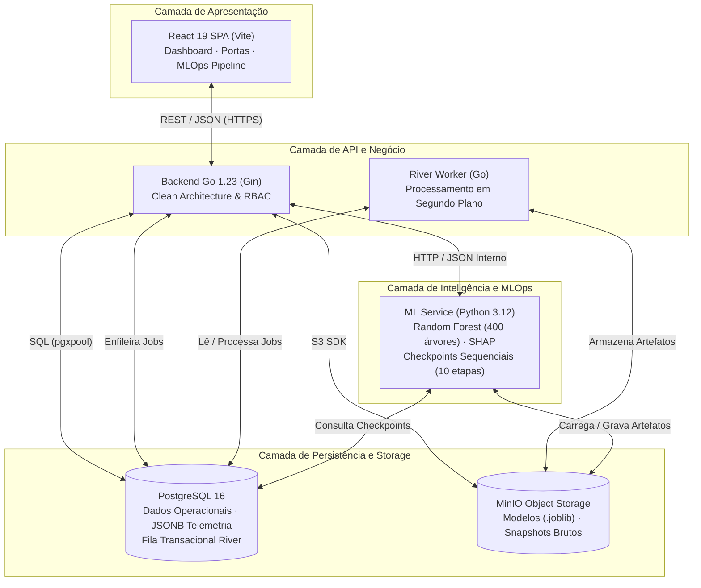

import { Image } from 'astro:assets';
import Background from '../../../../assets/sprints/sprint1/background_title.png';

<div style="position: relative; margin: 0 0 2rem 0; padding: 2rem; overflow: hidden; border-radius: 8px;">
  <Image src={Background} alt="Banner Motiva" format="png" style="position: absolute; inset: 0; width: 100%; height: 100%; object-fit: cover; z-index: 0;"/>
  <h2 style="position: relative; z-index: 1; color: white; margin: 0;">1. Introdução e Critérios Objetivos de Seleção</h2>
</div>

A definição da arquitetura de software para a plataforma de manutenção preditiva de Portas de Plataforma (*Platform Screen Doors* — PSDs) da Linha 4-Amarela do Metrô de São Paulo (concessão ViaQuatro / CCR) exige rigor na escolha de cada componente da pilha tecnológica. O sistema opera em um contexto de missão crítica: a indisponibilidade ou falha de uma porta em horário de pico acarreta atrasos em cadeia no carrossel de trens, superlotação nas plataformas, risco à segurança física dos passageiros e penalidades financeiras e regulatórias à concessionária.

Para assegurar que as decisões técnicas fossem sustentáveis e livres de escolhas arbitrárias, o grupo estabeleceu **cinco critérios objetivos de avaliação** que nortearam a seleção de cada tecnologia:

1. **Custo (TCO - Total Cost of Ownership):** Priorização de tecnologias de código aberto (*open-source* permissivo, como MIT, Apache 2.0 e BSD), sem custo de licenciamento proprietário e com consumo computacional otimizado, permitindo execução econômica tanto em servidores locais (*on-premise*) quanto em nuvem.
2. **Curva de Aprendizado e Produtividade:** Aderência ao conjunto de habilidades da equipe de engenharia e ciência de dados, permitindo entregas contínuas ao longo das cinco sprints sem comprometer o rigor metodológico.
3. **Maturidade do Ecossistema:** Escolha de ferramentas consolidadas no mercado corporativo e industrial, com documentação farta, comunidades ativas, suporte a longo prazo (LTS) e bibliotecas de integração estáveis.
4. **Aderência aos Requisitos Não Funcionais (RNFs):** Cumprimento estrito das metas de tempo de resposta da API (latência inferior a 500 ms em consultas operacionais), disponibilidade mínima de 99.5%, integridade transacional de dados de manutenção e isolamento de privilégios entre perfis de usuário (*Operator* e *Engineer*).
5. **Métricas de Desempenho:** Eficiência em tempo de execução, baixa pegada de memória RAM (*footprint*), capacidade de processamento concorrente sem bloqueio de I/O e velocidade de inferência e retreinamento dos modelos analíticos.

---

<div style="position: relative; margin: 0 0 2rem 0; padding: 2rem; overflow: hidden; border-radius: 8px; margin-top: 40px">
  <Image src={Background} alt="Banner Motiva" format="png" style="position: absolute; inset: 0; width: 100%; height: 100%; object-fit: cover; z-index: 0;"/>
  <h2 style="position: relative; z-index: 1; color: white; margin: 0;">2. Visão Geral da Arquitetura Tecnológica por Camadas</h2>
</div>

A arquitetura da solução foi projetada de forma modular e desacoplada, distribuindo responsabilidades em camadas bem delimitadas para evitar gargalos de processamento e garantir manutenibilidade independente.

A tabela a seguir sumariza as tecnologias selecionadas para cada camada do ecossistema:

| Camada Arquitetural | Tecnologia Adotada | Papel no Sistema | Alternativas Descartadas |
| :--- | :--- | :--- | :--- |
| **Apresentação (Frontend)** | React 19 + Vite + CSS Nativo | Interface SPA para monitoramento de risco, mapa da linha, catálogo de portas e governança MLOps. | Next.js (SSR), Vue.js, Angular, Tailwind CSS |
| **API e Orquestração (Backend)** | Go (Golang 1.23) + Gin Web Framework | Roteamento HTTP de alta performance, orquestração de regras de negócio, controle de acesso (RBAC) e agendamento assíncrono. | Node.js (Express/Fastify), Python (FastAPI), Java (Spring Boot) |
| **Inteligência e MLOps** | Python 3.12 + Scikit-Learn + SHAP + Joblib | Engenharia de atributos, inferência probabilística de falhas, explicabilidade local/global e pipeline de retreinamento com checkpoints. | XGBoost, Redes Neurais (LSTM/GRU), PyTorch, LightGBM |
| **Persistência Relacional e Filas** | PostgreSQL 16 + River Queue | Persistência transacional de ordens SAP, histórico de alarmes, usuários, predições, metadados MLOps e fila de jobs transacional. | MongoDB, MySQL, Redis + RabbitMQ |
| **Armazenamento de Objetos** | MinIO (Compatível com AWS S3) | Repositório local e seguro para snapshots brutos de dados, artefatos serializados (.joblib) e manifests de auditoria. | AWS S3 gerenciado, Armazenamento em disco local direto, Ceph |
| **Infraestrutura e Deploy** | Docker + Docker Compose + Golang-Migrate | Conteinerização uniforme de todos os serviços, paridade entre ambientes de desenvolvimento e produção, e versionamento de banco. | Kubernetes (K8s), Scripts Bare-metal, Ansible |



> [!TIP]
> **Ponto de Inserção da Imagem 1: Diagrama Isométrico da Arquitetura Tecnológica**
> Recomenda-se posicionar abaixo deste fluxo um diagrama isométrico 3D de alta resolução, ilustrando as camadas físicas e lógicas da plataforma.
>
> **Prompt detalhado para geração da imagem via IA (Midjourney / DALL-E 3 / Flux):**
> ```text
> A clean, modern, isometric architectural diagram of a high-tech predictive maintenance software platform for subway platform screen doors. Dark slate and navy blue background with crisp neon accents in electric blue, emerald green, and amber. In the top layer, a sleek web browser dashboard interface showing real-time metro telemetry and status indicators. Below it, microservices represented as glowing modular glass blocks connected by luminous optical fiber data streams: a high-speed Go API core, a Python machine learning engine with neural and decision tree graphical nodes, a robust relational database cylinder (PostgreSQL), and an object storage cube (MinIO). Clean isometric perspective, elegant corporate tech aesthetic, minimalist icons, no messy text, professional enterprise software architecture visualization, 8k resolution, cinematic studio lighting.
> ```

---

<div style="position: relative; margin: 0 0 2rem 0; padding: 2rem; overflow: hidden; border-radius: 8px; margin-top: 40px">
  <Image src={Background} alt="Banner Motiva" format="png" style="position: absolute; inset: 0; width: 100%; height: 100%; object-fit: cover; z-index: 0;"/>
  <h2 style="position: relative; z-index: 1; color: white; margin: 0;">3. Detalhamento e Justificativa por Camada Tecnológica</h2>
</div>

### 3.1 Camada de Apresentação: React 19 + Vite + CSS Custom Tokens

A interface com o usuário precisa atender a dois perfis distintos na Linha 4-Amarela: a **planejadora de manutenção (Marta)**, que necessita de visão espacial das 11 estações, listas de portas priorizadas e histórico de ordens, e o **engenheiro de confiabilidade/dados**, que audita o pipeline de retreinamento, métricas de modelo e desvio de dados (*drift*).

#### Justificativa por Critérios Objetivos:
- **Custo:** Totalmente gratuito, sem taxas de licença ou dependência de plataformas de hospedagem proprietárias.
- **Curva de Aprendizado e Produtividade:** React é amplamente dominado pela equipe de desenvolvimento. O uso do **Vite** substitui empacotadores legados (Webpack), proporcionando *Hot Module Replacement* (HMR) quase instantâneo (< 100 ms) e compilação de produção em menos de 300 ms via Rolldown/esbuild.
- **Maturidade do Ecossistema:** React 19 representa o padrão da indústria para aplicações ricas em estado (*Single Page Applications*), com suporte nativo a hooks performáticos (`useMemo`, `useCallback`, `useTransition`) que evitam re-renderizações desnecessárias ao renderizar listas volumosas de portas e alarmes.
- **Aderência aos RNFs e Desempenho:** A decisão de utilizar **Vanilla CSS com Design Tokens nativos** (em vez de frameworks utilitários volumosos como Tailwind ou bibliotecas de componentes pesadas como Material UI) garantiu um bundle minificado de apenas 212 kB de CSS e 530 kB de JavaScript, resultando em um *First Contentful Paint* (FCP) inferior a 0.8 s em redes locais.

#### Impacto Arquitetural:
- **Manutenibilidade:** Separação estrita de componentes reutilizáveis (`TrainingPipeline`, `AppLayout`, `Toast`, `TableStandard`), com folhas de estilo modulares correspondentes e isolamento de escopo. Ausência de dependências externas efêmeras que quebram em atualizações de versão.
- **Escalabilidade:** Como a aplicação é compilada como um conjunto de arquivos estáticos (HTML, JS, CSS e ativos otimizados), ela pode ser servida por qualquer servidor web leve (Nginx, Caddy ou bucket S3 estático), escalando para milhares de operadores simultâneos com consumo desprezível de servidor.
- **Confiabilidade:** O ciclo de vida dos componentes gerencia estados de carregamento (*skeletons*), erros de conectividade de rede com feedback via toasts não bloqueantes e cache local em memória para navegação instantânea entre abas sem refetch desnecessário.
- **Segurança:** Sanitização nativa contra ataques de *Cross-Site Scripting* (XSS) pelo motor JSX do React, ausência de injeção direta de HTML (`dangerouslySetInnerHTML`) e consumo da API backend exclusivamente via cabeçalhos tipados com tokens JWT de curta duração.

#### Riscos Identificados e Mitigação:
- **Risco:** Re-renderizações em cascata decorrentes do pooling frequente de telemetria de retreinamento.
- **Mitigação:** Implementação de controle de estado visual isolado no componente `TrainingPipeline`, sincronizado por `setTimeout` determinístico e comparação estrita de identificadores de job (`job.id`), impedindo que atualizações do pipeline forcem a re-renderização de toda a página de Engenharia.

---

### 3.2 Camada de API e Orquestração: Go (Golang 1.23) + Gin Web Framework

O backend funciona como o núcleo operacional da plataforma, integrando a interface React, o banco de dados PostgreSQL, o MinIO e o serviço de Machine Learning em Python.

#### Justificativa por Critérios Objetivos:
- **Custo e Consumo Computacional:** Go compila diretamente para código de máquina nativo sem necessidade de máquina virtual (como a JVM do Java) ou interpretadores em tempo de execução (como Node.js e Python). Em estado de repouso, o processo do backend consome menos de 28 MB de memória RAM, permitindo alocação em instâncias computacionais mínimas de baixo custo.
- **Curva de Aprendizado e Rigor de Engenharia:** A linguagem Go possui uma sintaxe deliberadamente compacta e ortogonal. A ausência de polimorfismo complexo de herança incentiva o uso de composição por interfaces, facilitando a adesão estrita à **Clean Architecture** (divisão entre `domain`, `usecase`, `port` e `adapter`).
- **Maturidade do Ecossistema:** Go é a linguagem padrão da infraestrutura de nuvem moderna (Kubernetes, Docker, Prometheus e Terraform são escritos em Go). O framework **Gin** oferece roteamento HTTP com árvore radix ultrarrápida, middleware de logging, recuperação de pânico e validação de requisições com sobrecarga de CPU inferior a microssegundos.
- **Aderência aos RNFs e Métricas de Desempenho:** O modelo de concorrência baseado em *Goroutines* (threads lógicas gerenciadas pelo runtime com custo de alocação de ~2 kB) permite que o backend atenda a picos de concorrência de milhares de requisições simultâneas sem bloqueio de I/O, entregando latência de processamento de rotas abaixo de 5 ms.

#### Impacto Arquitetural:
- **Manutenibilidade:** Implementação de arquitetura hexagonal limpa. As regras de negócio e casos de uso (`mlops_usecase.go`, `maintenance_usecase.go`) desconhecem detalhes de implementação de banco ou de clientes HTTP externos, operando exclusivamente sobre interfaces definidas na camada `port`. Essa separação viabilizou uma suíte de 273 testes unitários e de integração de execução ultrarrápida (menos de 2 segundos para rodar todo o pacote).
- **Escalabilidade:** Aplicação estritamente *stateless*. As sessões de usuário são validadas por assinatura criptográfica HMAC-SHA256 em tokens JWT, permitindo escalabilidade horizontal imediata através da inicialização de múltiplas réplicas do contêiner atrás de um balanceador de carga.
- **Confiabilidade:** Tratamento explícito de erros (sem exceções não controladas que derrubam o processo silenciosamente). O middleware de *Recovery* do Gin intercepta eventuais falhas críticas e retorna respostas estruturadas de acordo com a RFC 7807 (*Problem Details*), impedindo a indisponibilidade do serviço.
- **Segurança:** Sistema de autorização baseado em papéis (*Role-Based Access Control* — RBAC) aplicado diretamente nas rotas protegidas (`RequireRole("enginner")` e `RequireRole("operator")`). Proteção nativa contra injeção SQL assegurada pelo driver `pgx/v5`, que executa consultas exclusivamente via *prepared statements* parametrizados.

#### Riscos Identificados e Mitigação:
- **Risco:** Dependência de comunicação síncrona com o serviço de Machine Learning em Python, gerando risco de bloqueio da thread da API Go caso o treino demore minutos.
- **Mitigação:** Desacoplamento assíncrono. O endpoint de disparo de retreinamento (`POST /ml/retrain`) apenas cria o registro com status `queued` no PostgreSQL e retorna imediatamente o código HTTP `202 Accepted` ao cliente. A execução pesada roda em segundo plano através de goroutines monitoradas ou jobs do River, comunicando o progresso incrementalmente via banco de dados.

---

### 3.3 Camada de Inteligência e MLOps: Python 3.12 + Scikit-Learn + SHAP + Joblib

A camada analítica é responsável pela ingestão de logs de telemetria, tratamento de séries temporais de alarmes, separação temporal de dados, treinamento do modelo classificador e geração de explicações locais para os técnicos.

#### Justificativa por Critérios Objetivos:
- **Custo e Simplicidade Operacional:** O modelo adotado (**Random Forest com 400 árvores de decisão**) roda inferência de alta velocidade estritamente sobre CPU, eliminando a obrigatoriedade de instâncias com aceleradores gráficos dedicados (GPUs), cujo custo de operação mensal em nuvem é de 5 a 10 vezes superior.
- **Curva de Aprendizado e Ferramental:** Python é a língua franca da ciência de dados e machine learning. Bibliotecas como Pandas, NumPy e Scikit-Learn oferecem pipelines reprodutíveis de transformação de dados e serialização padronizada.
- **Maturidade e Robustez Teórica:** Enquanto modelos de Deep Learning (como redes LSTM ou Transformers) requerem milhões de registros para convergir e são altamente sensíveis a ruídos de medição em sensores industriais, o ensemble de árvores (*Random Forest*) apresenta estabilidade superior em bases de dados tabulares moderadas, lidando naturalmente com dados desbalanceados, não linearidades e valores atípicos (*outliers*).
- **Aderência aos RNFs e Explicabilidade Mandatória (XAI):** A operação metroferroviária exige conformidade e justificativa técnica antes de autorizar uma ordem de serviço. A biblioteca **SHAP** (*SHapley Additive exPlanations*), fundamentada na teoria dos jogos cooperativos, calcula com precisão matemática o peso de cada atributo (ex.: aumento de alarmes de obstáculo ou tempo desde a última preventiva) no escore final de risco da porta, eliminando a rejeição associada a modelos de "caixa-preta".

#### Impacto Arquitetural:
- **Manutenibilidade:** O serviço de ML foi organizado em arquitetura de microsserviço independente (`src/modelo`), expondo contratos formais documentados em especificação OpenAPI 3.0 (`openapi.yaml`). Isso permite que a equipe de ciência de dados ajuste hiperparâmetros, features ou regras de pré-processamento sem tocar em uma única linha de código do backend Go.
- **Escalabilidade:** A execução do treinamento foi dividida em um **pipeline sequencial de 10 etapas determinísticas**, gerenciado pelo componente `training_progress.py`. Cada etapa persiste seu estado em arquivo JSON local e no banco de dados, viabilizando o isolamento do processo de treinamento sem concorrência com o tráfego de inferência.
- **Confiabilidade:** Implementação de suporte a **retomada de treinamento a partir do último checkpoint**. Caso ocorra uma interrupção inesperada (como reinício do contêiner ou falta temporária de rede durante a extração SHAP), o pipeline é capaz de retomar exatamente da etapa com falha sem reprocessar as etapas anteriores que já haviam convergido com sucesso.
- **Segurança:** O serviço de inferência opera em rede interna restrita de contêineres Docker, sem exposição direta de portas para a internet pública, recebendo comandos autenticados exclusivamente originados do backend Go.

#### Riscos Identificados e Mitigação:
- **Risco:** Degradação da performance preditiva ao longo do tempo causada por mudanças operacionais na linha (desvio de dados ou *data drift* decorrente de novas frotas de trens ou troca de peças por novos fornecedores).
- **Mitigação:** Módulo de cálculo de drift baseado no teste estatístico de Kolmogorov-Smirnov e divergência de Jensen-Shannon integrado ao endpoint `GET /v1/models/{version}/drift`, sinalizando visualmente na aba de Engenharia a necessidade de disparar um novo ciclo de retreinamento.

---

### 3.4 Camada de Persistência e Filas: PostgreSQL 16 + River Queue + MinIO

A persistência de uma plataforma preditiva ferroviária precisa conciliar dados relacionais estruturados (contas de acesso, estações, portas, ordens de serviço) com dados semiestruturados (telemetria de checkpoints, logs brutos e artefatos binários de modelos treinados).

#### Justificativa por Critérios Objetivos:
- **Custo e Redução da Complexidade Arquitetural:** Em vez de adotar um banco relacional para dados, um banco de documentos para logs, um broker de mensageria externo (como RabbitMQ ou Apache Kafka) para filas e uma conta de nuvem comercial para storage, o grupo consolidou a persistência em duas ferramentas de código aberto: **PostgreSQL 16** e **MinIO**. Essa decisão reduziu drasticamente o custo de infraestrutura e a sobrecarga operacional da equipe.
- **Maturidade e Confiabilidade Transacional:** O PostgreSQL é amplamente reconhecido como o mais avançado banco de dados relacional de código aberto do mundo, com suporte pleno a garantias ACID (Atomicidade, Consistência, Isolamento e Durabilidade). O uso do tipo de dados nativo **JSONB** permitiu armazenar as 10 etapas detalhadas de progresso e telemetria de retreinamento (`ml_training_jobs.progress`) com indexação GIN sem abrir mão do esquema relacional estrito para as tabelas de negócio.
- **Fila Transacional com River:** A biblioteca **River** implementa uma fila de alta performance diretamente sobre tabelas do PostgreSQL usando recursos avançados da linguagem SQL (`FOR UPDATE SKIP LOCKED`). Isso elimina a necessidade de coordenar transações distribuídas: quando uma ordem de serviço preventiva é criada, ela é salva e enfileirada dentro da mesmíssima transação do banco, garantindo consistência estrita sem risco de perda de mensagens.
- **Soberania e Paridade de Armazenamento com MinIO:** O MinIO fornece uma API 100% compatível com o protocolo AWS S3, permitindo que a aplicação salve e recupere artefatos (.joblib, manifests e datasets brutos) exatamente como faria na nuvem, mas rodando de forma autocontida dentro do perímetro de rede local da concessionária, atendendo aos requisitos de soberania de dados do metrô.

#### Impacto Arquitetural:
- **Manutenibilidade:** Esquema de banco de dados centralizado e versionado por migrações incrementais em arquivos SQL puros (`000001` até `000017`), gerenciadas pela biblioteca `golang-migrate`. Qualquer evolução estrutural é rastreada no controle de versão e executada de forma idempotente tanto localmente quanto em produção.
- **Escalabilidade:** O banco de dados utiliza pooling de conexões eficiente através da biblioteca `pgxpool`, mantendo tempos de conexão estáveis e reutilizando sockets TCP. A fila River suporta múltiplos workers concorrentes que retiram tarefas do banco sem contenção de locks.
- **Confiabilidade:** Durabilidade garantida pelo mecanismo de *Write-Ahead Logging* (WAL) do PostgreSQL. O MinIO garante integridade referencial por meio de hashes MD5/SHA256 para cada objeto gravado, evitando corrupção silenciosa de modelos serializados.
- **Segurança:** Isolamento de rede dentro da bridge Docker, credenciais de banco e chaves de acesso S3 injetadas exclusivamente via variáveis de ambiente protegidas, e separação de esquemas impedindo acesso indevido entre camadas.

#### Riscos Identificados e Mitigação:
- **Risco:** Crescimento descontrolado das tabelas de fila do River e saturação de I/O em virtude de centenas de execuções de testes.
- **Mitigação:** Configuração de política de expurgo automático de jobs finalizados com sucesso e índices parciais focados exclusivamente em tarefas em estado pendente ou com falha.

---

### 3.5 Camada de Infraestrutura e DevOps: Docker + Docker Compose + Golang-Migrate

Para que uma solução acadêmica atinja maturidade industrial, a implantação precisa ser reproduzível com um único comando, independentemente do sistema operacional do desenvolvedor ou da máquina servidora da concessionária.

#### Justificativa por Critérios Objetivos:
- **Custo e Simplicidade:** A orquestração baseada em **Docker Compose** entrega virtualização leve no nível do sistema operacional sem os custos de licenciamento e a extrema complexidade operacional de clusters Kubernetes (K8s), cuja manutenção demandaria equipe dedicada de sustentação.
- **Curva de Aprendizado e Padronização:** Todos os integrantes da equipe e os avaliadores técnicos conseguem inicializar o ecossistema completo (Banco, Storage, Backend, ML Service e Frontend) executando simplesmente `docker compose up --build`.
- **Aderência aos RNFs e Imutabilidade:** Imagens de contêiner imutáveis garantem que as versões das bibliotecas (como scikit-learn 1.9.0 e Go 1.23) sejam rigorosamente as mesmas em desenvolvimento, homologação e no ambiente final do parceiro.

#### Impacto Arquitetural:
- **Manutenibilidade:** Cada serviço possui seu próprio `Dockerfile` enxuto com compilação em múltiplos estágios (*multi-stage build*). No caso do backend Go, a imagem final é montada sobre uma base `alpine` mínima, gerando um artefato seguro e compacto de menos de 45 MB.
- **Escalabilidade:** Facilidade de transição: caso o volume de dados da Linha 4 aumente e a concessionária decida migrar para um cluster em nuvem (AWS ECS, EKS ou GCP GKE), os mesmos manifestos e contêineres Docker serão reaproveitados sem necessidade de refatoração do código-fonte.
- **Confiabilidade:** Políticas de reinicialização automática (`restart: unless-stopped`) e *healthchecks* declarativos configurados no arquivo `docker-compose.yml` garantem que o backend aguarde a prontidão real do PostgreSQL e do MinIO antes de tentar inicializar as rotas e rodar as migrações.
- **Segurança:** Contêineres executados com privilégios reduzidos (usuários não-root) e isolamento de portas expostas: apenas as portas do frontend (5173/80) e do backend (8080) são expostas para consumo externo; serviços internos como o banco de dados e o ML Service comunicam-se exclusivamente pela rede privada do Docker.

#### Riscos Identificados e Mitigação:
- **Risco:** Conflito de portas locais e divergência de esquemas de banco entre desenvolvedores da equipe.
- **Mitigação:** Parametrização integral através de arquivo `.env` unificado e execução automática das migrações SQL no bootstrap da API Go via `golang-migrate`.

---

<div style="position: relative; margin: 0 0 2rem 0; padding: 2rem; overflow: hidden; border-radius: 8px; margin-top: 40px">
  <Image src={Background} alt="Banner Motiva" format="png" style="position: absolute; inset: 0; width: 100%; height: 100%; object-fit: cover; z-index: 0;"/>
  <h2 style="position: relative; z-index: 1; color: white; margin: 0;">4. Matriz Comparativa de Trade-offs e Gestão de Riscos</h2>
</div>

Toda decisão arquitetural envolve concessões deliberadas (*trade-offs*). A tabela a seguir documenta os ganhos obtidos e os custos de oportunidade aceitos pelo grupo ao selecionar as tecnologias do projeto:

| Escolha Tecnológica | Alternativa Descartada | Principal Ganho Obtido | Custo de Oportunidade / Desafio Aceito |
| :--- | :--- | :--- | :--- |
| **Go no Backend** | Python (FastAPI) ou Node.js | Baixa latência (< 5 ms), tipagem estática rigorosa e pegada de memória desprezível (< 30 MB). | Necessidade de manter dois ecossistemas de linguagens distintos (Go para API e Python para ML). |
| **Random Forest + SHAP** | Deep Learning (LSTM) ou XGBoost | Explicabilidade nativa mandatória para ferroviária e excelente estabilidade em dados tabulares com ruído. | Menor capacidade intrínseca de aprendizado de padrões sequenciais contínuos de altíssima frequência. |
| **PostgreSQL + River** | RabbitMQ / Kafka / Redis | Eliminação de brokers adicionais; transacionalidade estrita ACID entre dados de negócio e fila de tarefas. | Maior pressão de escrita e IOPS sobre o disco do banco de dados relacional sob tráfego severo de mensagens. |
| **MinIO Local** | AWS S3 Gerenciado | Soberania de dados operacionais metroferroviários e execução local com zero custo de tráfego de dados. | Responsabilidade própria de configuração de backup, replicação e sustentação de volume de disco. |
| **React 19 + CSS Nativo** | Next.js (SSR) + Tailwind | Aplicação cliente leve, bundle enxuto (< 750 kB total) e controle pixel-perfect sem abstrações de CSS. | Ausência de otimização de SEO nativa e necessidade de escrever tokens de design do zero. |
| **Docker Compose** | Kubernetes (K8s) | Simplicidade operacional máxima; qualquer membro sobe o ambiente completo com um único comando. | Ausência de mecanismos nativos de auto-scaling horizontal dinâmico e auto-healing distribuído em múltiplos nós. |

---

### Matriz Consolidada de Riscos e Mitigações

| Identificador do Risco | Camada Afetada | Probabilidade | Impacto | Estratégia de Mitigação Implementada |
| :--- | :--- | :--- | :--- | :--- |
| **R1: Quebra de Contrato Go / Python** | Integração Backend/ML | Baixa | Alto | Especificação rigorosa de contratos via OpenAPI 3.0 (`openapi.yaml` e `openapi.json`) e testes de integração automatizados que validam os payloads de entrada e saída a cada build. |
| **R2: Degradação do Modelo (*Drift*)** | Inteligência / MLOps | Média | Alto | Módulo dedicado de cálculo de desvio estatístico de features (`/drift`) e pipeline visual de retreinamento contínuo em 10 etapas acessível diretamente na interface pelo perfil *Engineer*. |
| **R3: Sobrecarga do PostgreSQL pela Fila** | Persistência / River | Baixa | Médio | Criação de índices parciais otimizados pelo River e rotinas de limpeza automática para expurgar registros de tarefas concluídas, mantendo a tabela de fila leve. |
| **R4: Falha no Retreinamento Longo** | MLOps / Treinamento | Média | Médio | Implementação de arquitetura de **checkpoints incrementais** no script `exportar_modelo.py` e endpoint de retomada (`/resume`), permitindo recomeçar da etapa com erro sem perder o processamento anterior. |
| **R5: Rejeição da Interface pela Operação** | Frontend / UX | Média | Alto | Concepção de interface minimalista e sóbria que reflete a linguagem do chão de fábrica e do SAP, complementada por explicabilidade visual em linguagem natural (motivos da classificação de risco). |

> [!TIP]
> **Ponto de Inserção da Imagem 2: Infográfico de Confiabilidade, Segurança e Mitigação de Riscos**
> Recomenda-se posicionar abaixo desta tabela um infográfico que sintetize os pilares de confiabilidade, segurança e continuidade operacional da arquitetura.
>
> **Prompt detalhado para geração da imagem via IA (Midjourney / DALL-E 3 / Flux):**
> ```text
> An enterprise-grade infographic visualization representing industrial software reliability, scalability, security, and maintainability for railway systems. A central glowing shield emblem surrounded by four balanced hexagonal pillars or quadrants labeled with subtle technical symbols: a speed gauge (low latency and high throughput), a lock and cryptographic key (security and data integrity), interconnected modular nodes (maintainability and clean architecture), and expanding network lines (horizontal scalability). Sleek dark theme with deep navy, brushed titanium silver, and cyber blue highlights. Highly polished digital rendering, technical blueprint feel, corporate technology report style, crisp geometric precision, 8k.
> ```

---

<div style="position: relative; margin: 0 0 2rem 0; padding: 2rem; overflow: hidden; border-radius: 8px; margin-top: 40px">
  <Image src={Background} alt="Banner Motiva" format="png" style="position: absolute; inset: 0; width: 100%; height: 100%; object-fit: cover; z-index: 0;"/>
  <h2 style="position: relative; z-index: 1; color: white; margin: 0;">5. Conclusão</h2>
</div>

As escolhas tecnológicas consolidadas nesta Sprint 4 equilibram maturidade industrial, aderência aos requisitos não funcionais e pragmatismo operacional. Ao optar por **Go** no backend, o projeto assegurou a robustez, velocidade e leveza necessárias para orquestrar dados operacionais e de mensageria com consumo mínimo de recursos. Ao concentrar o **Python** exclusivamente na camada de Inteligência e MLOps com **Random Forest e SHAP**, garantiu-se estabilidade estatística em dados tabulares ruidosos aliada à explicabilidade indispensável para engenheiros metroferroviários.

Por fim, a unificação da persistência no **PostgreSQL** com a fila **River** e o armazenamento de objetos no **MinIO** eliminou dependências complexas de nuvem e brokers externos, entregando uma solução coesa, segura, auditável e pronta para implantação sustentável na infraestrutura da concessionária.
